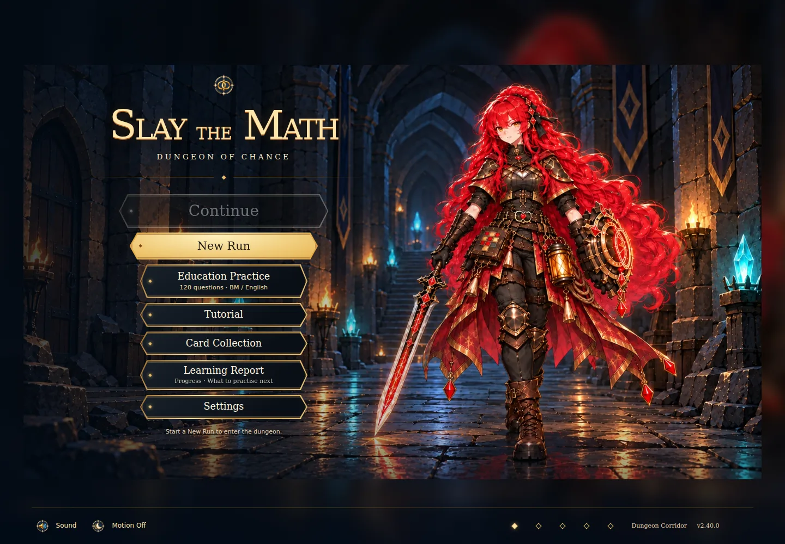

# Card tuning main integration — 2.40.0

Ijamm explicitly requests “okay then push dekat main then update the version!!”. This supersedes the earlier branch-only publication boundary for the completed card follow-up. Exact inputs: main `ade5d3a21e55b9d2911bfa935c8095c95801bd8c` /2.39.0 and feature `bb5f93b180616add5c7e16bb85fc91d9621d37df` /2.38.0-card-tuning.1; shared ancestor `37558d5a53d62e457c076b2444a1b71e8b42e50b`. Master SOR1.2.0 and current module/main audits were read before integration.

## Resulting behavior

- Last Page:1 Energy, Draw2 plus1 when Hand is empty after play. Focus/upgrade and empty-Hand ceilings unchanged.
- Recall:0 Energy, selected real Discard card returns once, Recall Exhausts. Existing Focus/upgrade draws remain.
- Ordinary Mana Barrier:7 Block per remaining Energy, X≥1. Master retains its existing7X and bonus allocation.
- AI choice ranking occurs outside actual-action telemetry capture. Last Page retains all three accessible Draw/Hand glossary targets in EN/BM.

[The feature owner](CARD_TUNING_2_38_0.md) records exact mechanics, old-save/payment/Shop contracts and the384-run exploratory comparison. Current new ordinary identity remains `card-effects-2`; complete unmarked/v1 definitions remain available. Master remains candidate.5 with separate keys. No additional numerical tuning is introduced during this merge. Last Page's small earlier cohort lost wins; publishing the approved values does not establish universal balance or pupil outcomes.

## Preservation and initial audit

Main's Result-only question reports, reviewed120-item bilingual help, private Google issue triage, six status-icon improvements, image readiness/fallbacks and Settings-only Developer access are retained. Runtime card/resolver/AI sources merge without a source conflict. Eight observed conflicts concern package/release/launchers, README and append-only SOR03/CHANGELOG; resolve by retaining both histories, choosing current main's package scripts and regenerating every launcher/cache URL as2.40.0. DECISIONS merges both histories. Original card/artifact/model/audio assets, question owners, map, enemy profiles and artifact numbers remain unchanged.

P1 integration risk: replacing older HTML/package content could remove the report/readiness scripts or the latest checks; preserve main's script graph and regenerate from it. P1 compatibility risk: existing ordinary v1 actions/offers must retain their own payment/resolver/preview rules; exercise real reload and UI cases. P2 metadata issue: publishing the feature's2.38 prerelease over current2.39 would regress the displayed version; use2.40.0. Existing DOC001/DOC002 documentation findings remain outside scope. No new confirmed gameplay bug was found during initial integration.

## Fresh verification

VALID in the integrated card/save/education/status/Dev scope. Fresh combined suite **991/991 passed**, zero failed/skipped/cancelled;55 focused checks passed. Syntax and production/portable build passed (304,023,003bytes). Native browser checks passed10 current/v1 card EN/BM cases,4 effects/original-save cases,3 Master profiles,6 report flows/18 viewport checks, actual zero-network portable report and full production/static-subpath Dev isolation. All16 tutorial images and88 input hashes match; the actual menu visibly shows2.40.0. [Verification manifest](verification/card-tuning-main-2-40-0.json), [scoped audit](audits/card-effects/LATEST.md).

Preservation checks confirm ten feature runtime/config sources exactly match the reviewed branch and21 current-main education/status/Dev owners remain byte-identical. Both prior ordinary archives and main's complete package scripts/entry script graph are preserved. Only actual tutorial screenshots change among existing asset files. The feature's958 and earlier main956 runs remain historical evidence.

First concurrent browser attempts crashed because /tmp had zero available space. Final native checks ran sequentially using writable QA temporary profiles; no game code was changed for that environment issue. Windows/physical devices, live Google/hosting and pupil win rates remain separate. Source PDFs/MODEL are not needed to merge this reviewed numerical card scope; no new source or model validation is claimed.

## Run the release

After pulling main, stop the old server and run `npm.cmd start` from the project folder. Open http://localhost:4173 and verify2.40.0. Start a New Run for the new values; saved ordinary runs retain their own rules. `npm.cmd run start:prod` builds the production player.

## Actual combined menu

