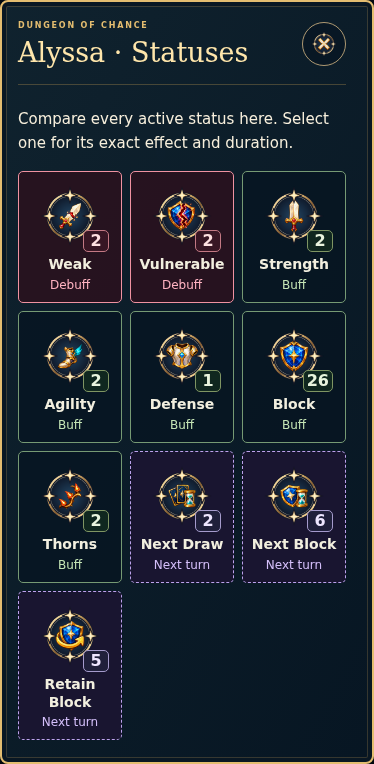

# Functional icon audit — branch preview (historical)

This records the original 2.31.1-icons.1 preview. Ijamm later authorizes publishing this update to main on 24 October 2026. The current merge, percentage-status/language compatibility and fresh checks belong to [main release 2.37.0](ICON_CLARITY_MAIN_2_37_0.md); the preview measurements below retain their original provenance.

Ijamm asks to inspect the actual game, assess whether its functional symbols have clear mappings, whether buff/debuffs can be distinguished quickly, and whether the icons are large enough. Card and artifact artwork is excluded. This preview is based on main **v2.31.0**, commit `6dc3ce366d266c33154f9b2e76afeb3bba224eca`, and is published only to **`codex/icon-clarity-audit`**, version **2.31.1-icons.1**.

## Findings and resulting behavior

| Priority | Observed in the running base | Change |
| --- | --- | --- |
| P1 | Phone fighter HP images were 16px; combat menu symbols were 23px; some seals were 20–24px. Their painted motifs occupied still less space inside the transparent image. | Role-based sizes: utility symbols normally 30–36px, fighter HP 28–32px, phone Energy/Focus/Draw 44px, seals 36–44px. Larger displays have explicit larger variants. |
| P1 | All ten status files were different, but their common gold frame dominated the small pictures. Only hover/inspection revealed their names. | Preserve the ten original pictures, enlarge them and display the name plus exact counter on each tile. Defense/Block, Strength/Weak and Block/Next Block/Retain Block now have readable names beside their distinct motifs. |
| P1 | Ten active statuses did not fit a phone rack. Local panning had no obvious all-effects entry point; urgent debuffs could be beyond the visible area. | Put Debuffs first, keep local scrolling and pin a count/All statuses action outside the scroll area. Its fighter-specific dialog displays every current effect. |
| P1 | A queued shield could be mistaken for current Block when only its picture/count was visible. | The overview explicitly says **Next turn**; queued tiles also use dashed purple borders. Buff and Debuff labels accompany the other colors. Exact expiry and retention wording remains in the existing detail view. |
| P2 | Rest's View Deck button used the Tutorial book. Soundtrack Shop used the Passive star; Mystery used a generic orb. The Hand image existed but was not used beside Hand count. | Use the existing cards, Shop, Mystery and Hand symbols in those roles. Rest soundtrack reuses the Camp/Rest seal. |
| P2 | Unknown utility keys silently inherited an orb. A Block-only preview still said `0 DAMAGE`. | Expose a QA marker for missing semantic keys; no generic orb conceals a missing mapping. Label a pure Block intent as Block, and a zero-attack preview as No Attack rather than inventing a Skill. |

The active palette already has enough artwork. No new status mechanics or bitmap redesign is needed for this correction. Reusing a picture is intentional only for the same meaning, such as Rest/Camp or a speaker across independently labelled audio controls. Ordinary text buttons, mathematical notation and scene decorations do not need unique decorative pictures.

## Inventory and sizing contract

The [inventory CSV](verification/icon-clarity-2026-10-24/icon-inventory.csv) lists **45 UI bindings, 10 status bindings and 6 map bindings**, pointing to **58 unique existing artwork files**. Shared Rest/Shop/Mystery aliases account for the difference. Available legacy symbols are retained rather than turned into new mechanics. The source-authoritative selected card/artifact mappings and all asset bytes remain unchanged.

| Role | Current CSS image box |
| --- | --- |
| Core utility | At least 28px; menu 30–32px, mixer 36px |
| Fighter HP | 28px narrow, 32px desktop, 40px large display |
| Phone Energy / Focus / Draw | 44px |
| Boss seal | 36px narrow, 44px desktop, 52px large display |
| Inline status | 56px desktop; 48px narrow portrait; 32px short landscape with its visible name; 72px large display |
| Status comparison | 72px normally, 64px short landscape, 96px large display |

Touch targets stay at least 44×44px. The inline rack reserves its own room below HP; its count button stays outside the panning region. The modal retains native internal scrolling on short screens. Long numeric counters cannot cover adjacent icons; the exact value remains in the accessible name and detail text. The Passive rail caption stays within the viewport while its original card pictures are untouched.

Names, values, type labels, distinct glyphs and queued border shapes work together; the interface does not rely only on color or hover. This is an implementation/readability judgment, not a measured pupil-recognition result.

## Actual preview

Desktop comparison:

Phone comparison:

## Verification

- **95 selected UI/asset/status/tutorial/save regressions passed**, zero failures and skips. These include original-art hashes, unchanged card frames and actual status expiry behavior.
- `npm run check` and the new test-file syntax checks passed. `npm run build:prod` passed; the generated portable output is 298,539,538 bytes.
- Real Chromium inspection checked **38 rendered screen states** across **1920×1080, 1280×720, 390×844, 320×740, 844×390 and 3840×2160**. Scenes include Home, mode selection, Sound/expanded soundtrack, Settings, map, Rest, Shop, reward, victory/defeat, Mystery intro/question, artifact-question UI, Predict, Collection UI and Tutorial. Card/artifact art remains outside the resizing scope.
- Actual utility keys have no missing-marker fallback, visible named utility images meet the 28px minimum, and crowded status targets meet 44px minimums. Combat stays within one viewport. Enter/tap opens the overview; detail/back/Escape works and focus returns to the original trigger. Raw saved gameplay is identical before/after inspecting icons.
- The actual generated `file://` game displays all ten comparison icons from embedded data, opens canonical status details and preserves the save, with zero network/dependent local asset requests.
- `git diff --check` passed. No image assets, original card/artifact registries, card renderer, artifact renderer or gameplay data were changed.

Machine-readable measurements and limits: [report.json](verification/icon-clarity-2026-10-24/report.json). Reproduce the focused checks with `npm run test:icon-clarity` and `npm run test:icon-clarity-browser`; optional `QA_PRODUCTION=1 QA_OFFLINE=1` tests built output. As with existing QA, isolated JSDOM/Playwright may be supplied through `DOM_QA_MODULE` / `BROWSER_QA_MODULE`, and image decoding through `IMAGE_QA_MODULE`. Real Windows hardware and pupil glance recognition remain to be assessed.

Owners: [Icon SOR, ICO-15–19](sor/06_ICON_SYSTEM.md), [UI SOR](sor/10_UI_UX_ACCESSIBILITY.md), [original branch decision](sor/DECISIONS.md#dec-20261024-icon-clarity--functional-icon-audit-branch-only). The original main-publication restriction is superseded by DEC-20261024-ICON-CLARITY-MAIN, following Ijamm's later explicit instruction.
