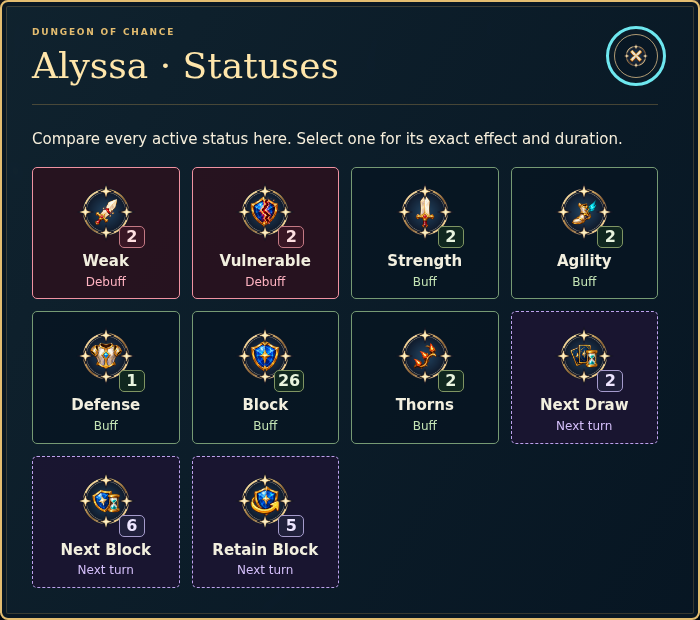
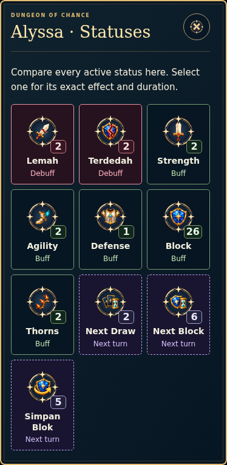

# Functional icon clarity on main — 2.37.0

24 October 2026, Asia/Kuala_Lumpur. Ijamm explicitly requests “okay push ini pula please”, authorizing publication of the icon update to main. This supersedes the earlier branch-only restriction. The release joins the existing functional-icon work to the current game; original card and artifact illustrations remain outside the icon-resizing scope.

| Input | Verified Git snapshot |
| --- | --- |
| Repository | `unDead41/slay-the-math-v2` |
| Main, game 2.36.0 | `50d3af423cdc2240e949f4ddf29e023865304b65` |
| Icon branch `codex/icon-clarity-audit` | `b18c4c99d28530026f8d90d28964569c2f7af610` |
| Common base, game 2.31.0 | `6dc3ce366d266c33154f9b2e76afeb3bba224eca` |
| Combined game version | **2.37.0** |

## Resulting behavior

Functional symbols use the role-based sizing in ICO-16. The ten status pictures have visible names and exact counters; urgent debuffs lead the display. A reachable All statuses button opens every current effect for the selected fighter, with Buff, Debuff and Next turn labels. Details retain the canonical effect, duration and count. Keyboard/touch, local scrolling, Escape and focus return remain native. Status inspection never changes gameplay.

Existing artwork supplies the correct Hand, View Deck, Shop, Rest and Mystery meanings. Pure Block/no-attack previews describe their actual intent instead of displaying zero damage or implying a fictional Skill. Unknown icon keys receive an explicit QA marker. No new status mechanics or bitmap redraw is introduced.

## Integration with newer main

The original preview predates several main updates. The nine textual merge conflicts are resolved by retaining the current owners and both documentation histories:

- `dist/app.js` keeps current run-aware card display helpers, education retry focus and continuation behavior. Only the icon presentation and its new action are added. Inline/comparison/details pass `QL.language()` to the current status owner, preserving BM percentage/duration descriptions.
- Current Weak −25% and Vulnerable +50% use their real remaining attack phases. Archived ordinary saves continue to describe their original flat-hit rules. `dist/combat-status.js`, numerical card data and the combat engine are unchanged from main.
- `package.json` retains all AI/education/developer scripts and adds the two icon checks. Release/cache metadata and all three entrypoints are regenerated for 2.37.0.
- SOR append conflicts retain both histories. ICO-19 and DEC-20261024-ICON-CLARITY-MAIN record the later main authorization.
- All 16 tutorial views are recaptured from the actual merged UI with isolated deterministic fixtures. Thirteen encoded pictures change; unchanged captures retain their hashes. `docs/tutorial/screenshots.json` records the actual runtime-input hashes, image hashes, base commit and dirty integration state. These captures are QA evidence, not new game artwork.

Main's education workspaces/two-attempt rules, current VFX/audio, AI, optional collection behavior, production Dev gate/isolation, save keys and original art remain under their existing owners. The original [preview report](ICON_CLARITY_AUDIT_2026_10_24.md) and its measurements remain historical evidence of that earlier build.

## Fresh combined-tree verification

Status: **VALID within the tested integration scope**. Evidence is in [integration.json](verification/icon-clarity-main-2-37-0/integration.json) and its accompanying raw logs/reports.

| Check actually run | Result |
| --- | --- |
| `npm test` on the combined source | **923 passed, 0 failed, 0 skipped**; 401,444ms. |
| `npm run check` and changed QA-script syntax | Passed. |
| `npm run build:prod` | Passed; portable game **303,072,585 bytes**. |
| Production icon browser audit | **41 rendered states**, six viewport sizes from 320px phone to 3840×2160; named utility symbols ≥28px, status actions ≥44px and comparison artwork ≥64px. No missing semantic mapping or page errors. |
| Native status controls and language | All ten effects, exact counters, fighter-specific views, current BM percentage/duration descriptions, archived flat-hit details, Enter/tap, detail/back/Escape and focus return pass. Inspection preserves raw saved gameplay. |
| Generated offline icon game | All ten pictures decode from embedded data, details work, save stays identical, no network or dependent local asset requests. |
| Production tutorial browser | All 17 chapters/11 practical exercises, image decoding, BM, zoom, narrow/short layouts, Master Medium, storage denial, timed Mystery warning and embedded offline exercise pass. |
| Production status-VFX browser | Ten checks, three viewports and Easy/Medium/Hard: actual action/turn gameplay equality, shield/status effects, native modal/reduced-motion lifecycle, isolated saves and offline behavior pass; zero errors/asset requests. |
| Production Developer Hub under `/slay-the-math-v2/` | Password/cancel/settings, isolated preview and player copy, free map entry, all 15 events, upgraded card insertion, exact questions, status editing, scenarios, reports and real production-server routing pass. |
| Preservation and generated resources | All 83 runtime resources match the production build, accounting for the unchanged Dev-access app projection. All 16 captured image hashes and 84 tutorial source-input hashes match. Original card/artifact/gameplay/question/audio/VFX/developer owners remain unchanged. |

The additional VFX run exposed a **stale browser-test expectation**, not a game regression: it expected Weak to decrease on a single Attack. The real current engine and presentation modules are byte-identical to main, keep Weak=2 after Rune Strike, then reduce it to 1 with an actual −1 Weak cue at phase end. The browser assertion now verifies both boundaries and exact engine/save equality. The original failing run is retained as `status-vfx-before.*`; the corrected full browser run is `status-vfx-browser.*`. No runtime fix or numerical change was required.

Current status comparison, captured from production:





## Reproduce the game

```sh
git switch main
git pull --ff-only origin main
npm run start:prod
```

This rebuilds the production player from the checked-out source. An already running Windows server or browser page does not change merely because a remote Git ref is updated.

## Limits

Native Chromium automation and deterministic engine checks cover the specified production/offline surfaces. They do not establish pupil glance-recognition rates, classroom comprehension, physical Windows/mobile behavior, live Google collection or public Pages deployment. MODEL.zip was unavailable and is not used. The supplied PDFs are not changed by this release.
