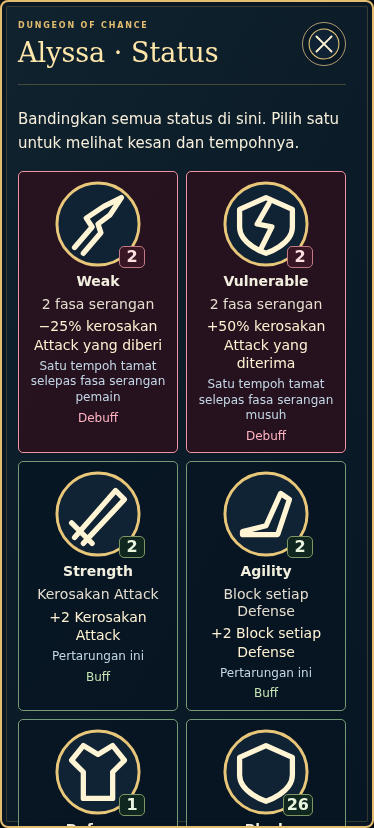
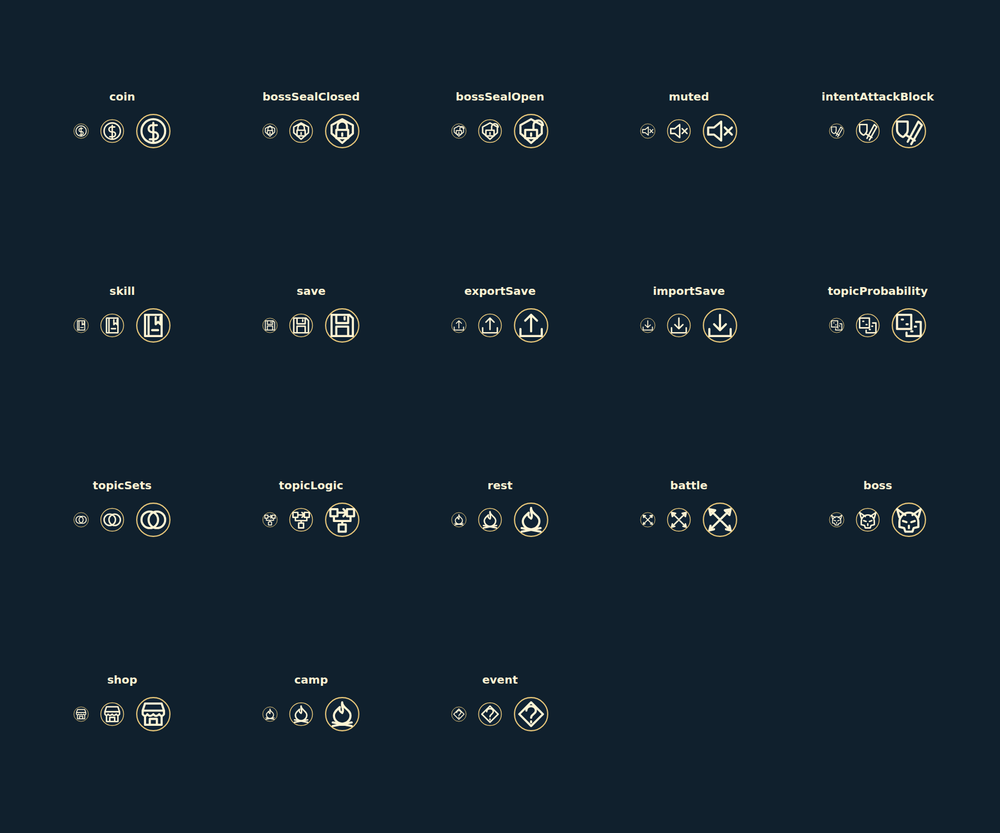

# Icon loading follow-up — 2.45.1-icons.1

25 October 2026, Asia/Kuala_Lumpur. Ijamm authorizes the appropriate fixes from the latest-main icon audit and a push to `codex/icon-clarity-audit` only.

Base main: `6c49f3980c3a832635d4d01a6c50a8df98ac4aad`, game 2.45.0. Existing remote icon branch: `81533b38b8c7be1d897c3acc282f749df9beaeab`, already an ancestor of main. Advance from current main, retaining V5 actor motion, live VFX, bilingual support, balance/AI and all other owners. Master SOR 1.2.0, AGENTS, related audits and owner documents were read first.

## Resulting behavior

- A visible image promotes its existing queued preparation to foreground priority. It shares the verified transfer and decode promise. Completed transfers/in-progress decoding do not fetch bytes again, including when session Blob retention is disabled.
- All 43 registered UI keys and six map meanings have local semantic SVG fallback glyphs. All ten status fallback glyphs remain unchanged. Rest/Camp intentionally share a meaning; Defend's shield-plus differs from Block, as do open/closed Boss Seals, Focus/Predict, Tutorial/Skill and Draw/Discard/Exhaust.
- Failed map/legend/topic images without explicit semantic attributes recover their meaning from the original registered asset identity. Blob/placeholder URLs do not erase that identity. Unknown resources retain a warning; fallback generates no further network request.
- Named controls, counts, language and Normal/Large settings retain their existing owners. No gameplay transaction or persistence rule is added.

`dist/bootstrap.js` forwards a lower priority only while the original transfer is pending. `dist/asset-readiness.js` already owns scheduling/deduplication and remains byte-identical to main. `dist/icon-readiness.js` owns fallback glyphs and source-to-meaning lookup. The fifteen-icon critical list and verified transport remain authoritative.

## Evidence and limits

The complete production bootstrap/manager regression initially leaves Weak queued behind two held background transfers with spare foreground capacity. After the fix Weak reaches ready before either transfer finishes, with one request and one source decode. A second gate holds decoding after bytes arrive, disabling session retention to detect an accidental refetch.

Fallback regressions initially find the same warning for registered utility meanings and an unlabelled map image. After correction, actual failed buttons keep names and distinct glyphs; changing a map source updates its meaning. Card/artifact artwork remains excluded by the existing selector.

The native production test holds two actual status HTTP requests, then opens a real saved battle. Weak becomes ready through one request before either response is released; the raw saved game is identical. Other cases return HTTP 404 for every functional bitmap: Enter remains available, the ten-status comparison and six-item map legend remain usable, and BM/English plus Normal/Large switching preserves saved gameplay.

Diagnostic sheets render actual fallback outputs at 28/44/64px, at most twenty meanings per sheet with CSS 100px padding/gaps. These are QA contact sheets, not game screenshots or replacement 4K artwork. Normal painted images, transparency, exports and all original asset bytes remain unchanged.

Commands: `npm run test:icon-clarity` includes the combined bootstrap tests; `QA_PRODUCTION=1 npm run test:icon-loading-browser` checks production and the actual generated standalone file. Existing browser QA module/Chromium environment options apply. Fresh full regression passes **1,085/1,085**, zero failed/skipped; focused21/21, all five native groups, syntax/build and678/679 source/production resource hashes pass. The separate image-consumer check covers31 Artifact Codex images and all17 Tutorial chapters with no raw requests/errors. Exact results and limits: [audit](audits/icon-clarity-audit/LATEST.md) and [evidence](verification/icon-loading-20261025).

Physical-device performance and human recognition remain unmeasured. DOC-001/DOC-002 were corrected in main 2.43.0; the older broad Publish Handler concern was resolved in 2.41.0. The priority defect above is a newer, narrower boundary issue. MODEL.zip was unavailable and not used. Mathematics PDFs are outside this unchanged-content task. No live Google or main/Pages deployment belongs to this branch update.

