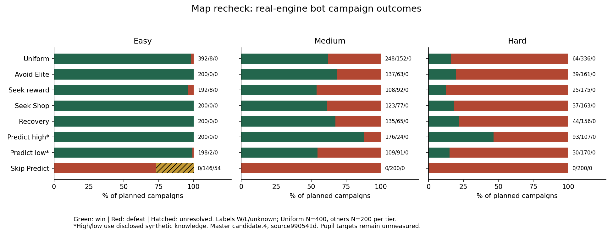

# Map Balance v1.4 — handoff kepada Master

**Rekod sejarah candidate.4/game2.37.0.** [Regresi candidate.5/game2.40.0](MAP_BALANCE_V1_5_HANDOFF.md) mempunyai konteks dan hasil berasingan. Data di bawah tidak dilabel semula. Terbitan kandungan asal8606616a475f21cc95bc5e4fc202c8914498bd78 telah disahkan pada balance/map.

24 Oktober 2026, Asia/Kuala_Lumpur. Repository `unDead41/slay-the-math-v2`; branch penerbitan `balance/map`.

**VALID untuk integriti eksperimen dan keserasian runtime yang dinyatakan.** CP masih PROVISIONAL; scope yang censored atau tiada entry kekal tidak mempunyai skor. Kelulusan balance akhir dan sasaran murid 90%/70%/50% ialah **BELUM DISAHKAN**.

## Sumber sebenar dan keserasian

| Sumber | SHA / keadaan |
| --- | --- |
| Runtime main yang diukur | `990541d57c6df96cefb21eddc7a365d1d989a74d`, game 2.37.0 |
| Map sebelum recheck | `5480273cb28752741f3043f8d23753aa0374902d`; sudah berada dalam main, 42 commit di belakang ketika mula |
| Main penutupan yang disepadukan | `37558d5a53d62e457c076b2444a1b71e8b42e50b`, game 2.37.1 |
| Master input asal | `8b6a3c688dc83db31685cdc7ec653ee25554e62d`, ancestor main |
| Combat semasa | `3a62324ba05de14bd27774a565a5a048e7aa404a`; recheck baharu untuk Master, belum digabungkan oleh Map |
| Economy semasa | `2e54f2b2107289925d936cb65d1ab86fd823ff96`; recheck baharu untuk Master, belum digabungkan oleh Map |
| Card effects | `a9c49f03f5e60dc0309f90931469361e6febedee`; sudah diintegrasikan dalam runtime |

Master SOR 1.2.0 dan audit/handoff semasa dibaca. Main bertambah dengan Settings-only Dev dan pembetulan metadata versi semasa batch berjalan. **29 fail input engine adalah byte-identical; satu perbezaan metadata ialah `package.json.version` 2.37.0 → 2.37.1.** Lihat [parity sumber](../reports/map-balance/validation-v1.4/main-compatibility.json). Keputusan tidak dilabel semula sebagai batch 2.37.1. Branch mengekalkan perubahan main termasuk versi 2.37.1; data lama disahkan melalui sumber asal yang dibekukan.

Konflik teks SOR semasa penyelarasan diselesaikan dengan mengekalkan kedua-dua sejarah. Tiada konflik mekanik dikesan. Nilai kad, musuh, harga, soalan, save, grafik, topology dan UI pemain kekal di bawah pemilik sedia ada. Map CP tidak dipaparkan pada UI pemain.

## Perubahan audit yang disahkan

| Kategori / keutamaan | Penemuan dan hasil |
| --- | --- |
| MASALAH DISAHKAN / P1 / tinggi | Worker lama tidak mengikat integrated difficulty. Adapter kini menggunakan `loadMaster` + `createReplay(runtime)` sebenar, menyimpan identiti dan menolak captured profile yang berbeza. |
| MASALAH DISAHKAN / P2 / tinggi | Affordability artifact mengabaikan multiplier difficulty. Pemerhatian kini menggunakan `E.shopPrice`, sama dengan transaksi pembelian. |
| MASALAH DISAHKAN / P2 / tinggi | Laporan menolak legacy 60 Gold selepas kemenangan. Master memberi 0 Gold pada boss terakhir; konvensyen ini disahkan melalui API runtime dan digunakan secara eksplisit. |
| MASALAH DISAHKAN / P1 / tinggi | Semakan bebas dahulu boleh menerima skor campaign/Predict yang salah jika JSON dan CSV diubah serentak. Enam negative fixtures gagal sebelum pembetulan; kini semua ditolak melalui kiraan cohort mentah, CP/Wilson, nullability dan bounds. |
| MASALAH DISAHKAN / P1 / tinggi | Pemeriksa mengesan perbezaan jumlah persisted/index. Resume hanya task ID yang tiada dengan input yang sama; semua loss/censor sedia ada dikekalkan. Set akhir disahkan lengkap dan unik. Punca storage persekitaran belum dibuktikan. |
| RISIKO BERPOTENSI / P1 | Hard sensitif kepada laluan, recovery dan question/artifact/seal gates. Angka bot di bawah menyokong triage, bukan satu punca tunggal atau kadar murid. |
| RISIKO BERPOTENSI / P2 | `shopGoldSpent` cohort ini ialah jumlah penurunan Gold bersih setiap tindakan; paid Purse mengimbangi sebahagian bayaran. Field `shopGoldSpentBasis` menyatakannya. Net room/final Gold dan outcome tepat; jangan tafsir sebagai gross checkout spending. |
| PENAMBAHBAIKAN / P2 | Arkib 63 fail sumber/input/analisis, manifest, pemulihan cold source dan tiga exact full-trial replay membolehkan Master menyemak cohort asal selepas main berubah. |

## Protokol, deck dan skor

Runtime **`master-1.4.0-candidate.4`**, definition `49a62f950a6208243e2f4afa237d9b19bb6995247688d869f3c28dc6c1b3f194`, engine `d73ee204a4bf0613208eb75ee63249ace7c41c1e08040f13864ce4f35d79ca93`. Mode Challenge dengan profile sebenar; tiada multiplier Learn tambahan. [Input lengkap](../reports/map-balance/v1.4/runtime-inputs.json) menyimpan profile, starter dan template musuh; template perlu dibaca bersama multiplier, defense, phase dan Rage engine.

Starter sebelum starting-artifact: Rune Strike×3, Weak Point×3, Rune Guard×2, Flash Ward×2, Quick Study×1, Read Ahead×1 (12 kad). Base HP/Gold: Easy70/100, Medium65/80, Hard60/70; starting Focus setiap combat1/0/0. Entry sebenar diambil selepas trial starting-artifact; artifact boleh gagal diperoleh. Setiap triplet mengekalkan deck/HP/Gold/artifact/state/clock/RNG yang sama dalam profile tersebut. Entry merentas seed boleh berbeza melalui reward sebenar; skor ini bukan kesan topology yang telah diasingkan daripada semua RNG/reward. Stage2 ialah survivor bank sebenar, bukan state yang direka.

Polisi combat/acquisition rujukan ialah visible greedy/heuristic yang direkodkan; bukan player optimum atau ICP/CCP. Routing hanya menggunakan kategori room, edge, HP dan Gold. Health-recovery menggunakan ambang50% HP; seek-Shop menggunakan heuristic60 Gold, manakala affordability sebenar dikira selepas masuk Shop.

Setiap difficulty: uniform4/seed (400), empat polisi adaptif2/seed (800), high/low/skip Predict2/seed (600): **1,800 campaign setiap tier**. Kawalan feedback Predict menggunakan semula recovery200. [400 runSeed](../reports/map-balance/v1.4/run-seeds.csv) dikongsi mengikut repetition merentas syarat/profile. Feedback memilih jawapan terlihat yang belum dicuba, mematuhi had dua salah. High/low menggunakan canonical key secara sintetik85%/25% cubaan pertama, satu attempt; Mystery/artifact mengekalkan feedback. Jam satu saat/jawapan bukan masa membaca murid.

CP menggunakan `p=(W+0.5)/(N+1)` dan `1000 ln(1/p)/ln(1/0.70)`, dengan Wilson95 daripada W/N dan interval CP terbalik. Anchor0.70 ialah skala, bukan bukti target tercapai. `null` ialah tidak diukur/unresolved. CP map/laluan berbeza daripada kuasa kad dan deck-merit heuristic. N kecil (maksimum4 entry/seed/stage), populasi Stage2 bersyarat dan repeated seeds mengehadkan tafsiran. Data v1.3 berbeza runtime/budget/method; jangan gunakan delta CP sebagai kesan balance terasing.

Had asal:100 turn/500 paid plays/10,000 API actions,120 saat/task, maksimum8 worker. Selepas proses8-worker terhenti exit137, baki dijalankan dengan3 worker; hanya missing-task recovery menggunakan1 worker. Censor/loss tidak diganti. `elapsedSeconds` ialah invocation terakhir; log pelaksanaan merekod proses asal/resume.

## Keputusan campaign penuh

Angka ialah **menang / kalah / censored**, bukan murid. Uniform N400; syarat lain N200 setiap tier.

| Polisi | Easy | Medium | Hard |
| --- | ---: | ---: | ---: |
| Uniform (400) | 392 / 8 / 0 | 248 / 152 / 0 | 64 / 336 / 0 |
| Avoid Elite (200) | 200 / 0 / 0 | 137 / 63 / 0 | 39 / 161 / 0 |
| Seek reward (200) | 192 / 8 / 0 | 108 / 92 / 0 | 25 / 175 / 0 |
| Seek Shop (200) | 200 / 0 / 0 | 123 / 77 / 0 | 37 / 163 / 0 |
| Recovery (200) | 200 / 0 / 0 | 135 / 65 / 0 | 44 / 156 / 0 |
| Predict high (200) | 200 / 0 / 0 | 176 / 24 / 0 | 93 / 107 / 0 |
| Predict low (200) | 198 / 2 / 0 | 109 / 91 / 0 | 30 / 170 / 0 |
| Skip Predict (200) | 0 / 146 / 54 | 0 / 200 / 0 | 0 / 200 / 0 |

Perbandingan polisi yang dipadankan menggunakan200 runSeed/entry yang sama: recovery menambah20 kemenangan pada Medium dan20 pada Hard (**+10 mata peratus** masing-masing). Avoid-Elite +11 pp Medium/+7.5 pp Hard; seek-Shop +4/+6.5 pp. Seek-reward −3.5 pp Medium tetapi +0.5 pp Hard pada subset yang dipadankan. Jangan bandingkan subset200 terus dengan keseluruhan uniform400; reward tambahan tidak menjamin hasil lebih baik. Semua ini bundled route/RNG/reward effects, bukan sebab-akibat satu room.

Skip Predict: Easy0/146/54; Medium0/200/0; Hard0/200/0. Kes Easy yang unresolved memberi all-case win bounds0–27%, CP null. Predict juga membuka seal; skip bukan ujian Focus sahaja. Starting/artifact/Passive Focus tidak dipadam. Lihat [54 case tepat](../reports/map-balance/v1.4/censored-cases.csv) untuk replay/triage Master.

## Laluan setara, recovery dan coverage

| Difficulty | Campaign | Matched replay | Entry Stage1 / Stage2 | Laluan 10 node dilawati / 5,500 | Raw integrity | Score gate |
| --- | ---: | ---: | ---: | ---: | --- | --- |
| Easy | 1,800 | 2,400 | 400 / 400 | 1,635 | PASS | FAIL:54 censored |
| Medium | 1,800 | 2,352 | 400 / 384 | 1,558 | PASS | PASS |
| Hard | 1,800 | 2,034 | 400 / 278 | 1,247 | PASS | PASS |

**12,186 rekod**:5,400 campaign +6,786 matched stage replay;0 engine/policy error,0 invalid state. Semua100 seed/200 graph sepadan dengan snapshot asal dan **5,500 laluan distrukturkan sepenuhnya**. Coverage10 node bermaksud semua node hingga boss dimasuki, termasuk kalah di boss; ia bukan kemenangan atau semua encounter selesai. Adaptive death prefixes kekal dalam raw, tidak diberikan full-route ID rekaan. Angka profile mengulang graph yang sama, bukan600 graph berbeza.

Label easiest/lower-median/hardest ialah nominal pressure reference yang dipilih sebelum outcome. Model itu tidak memodelkan peratus/fasa dan pertumbuhan deck semasa. Hardest−easiest pada entry setara: Easy Stage2 −27 kemenangan/400; Medium Stage1 −38/400, Stage2 −94/384; Hard Stage1 −144/400, Stage2 −62/278. Terdapat0/6/10 point inversions bagi Easy/Medium/Hard. Contoh Medium STM-034 Stage2: nominal easiest1/4, hardest3/4. N4 tidak cukup untuk melabel semula kesukaran akhir berdasarkan point estimate sahaja.

**Hard STM-064 Stage2 tiada uniform survivor entry**; ketiga-tiga rank mengekalkan null CP/NEEDS_STAGE_ENTRY. Tiada Stage2 palsu dicipta. Replay Stage1 berhenti selepas boss1; ia tidak membuktikan downstream Stage2 bagi setiap counterfactual route pair. Campaign polisi penuh membawa HP/deck/reward sebenar melalui kedua-dua stage. Semua77,384 pasangan laluan campaign hanya dienumerasi secara struktur/anggaran, bukan dimainkan semuanya.

Triage46 forced-Elite maps (22 Stage1/24 Stage2) dan62 tanpa Rest sebelum9 (36/26) dikekalkan. Pada Stage2, kematian sebelum Rest pertama dalam kumpulan no-early-Rest ialah Easy4/312, Medium74/302, Hard140/221 feedback-policy arrivals. Forced-Elite ialah1/288,66/277,112/201. Kumpulan bertindih; **jangan jumlahkan** bilangannya. [Cohort disjoint](../reports/map-balance/v1.4/structural-cohort-outcomes.csv) memisahkan pertindihan. Ini pemerhatian berulang/conditional, bukan kesan sebab-akibat Rest atau Elite. Rest tidak sama dengan semua recovery: Mystery, kad dan artifact juga boleh memulihkan HP.

## Cadangan untuk Master

1. **P1 — recovery Hard sebelum Rest9:** semak seed/route yang mati selepas Elite chain atau Mystery penalty melalui difficulty-drivers/recovery-windows. Uji calon katalog/generator berversi yang memberi akses recovery/Shop lebih awal; nilai semula quota dan peluang reward, serta kekalkan snapshot/save lama. Kontrak Mystery5/Rest9/Boss10 dan dua stage tidak berubah oleh audit ini.
2. **P1 — seal/soalan/artifact ability:** gabungkan dengan Combat/Economy dan playtest murid. Fokus pada pacing, bantuan dan peluang membina deck; jangan menaikkan semua Focus atau menurunkan semua musuh untuk memaksa bot mencapai90/70/50. Focus-only contrast memerlukan kawalan seal dan peluang soalan berasingan.
3. **P2 — risiko–ganjaran dan Shop:** gunakan HP/deck/upgrades/artifacts ketika masuk boss serta transaksi/affordability sebenar; Gold berbaki bukan bukti pendapatan berlebihan. Economy2e54f2b membetulkan gross Purse flows. Rekonsiliasi shared telemetry untuk cohort baharu; raw cohort ini kekal dengan basis net yang dilabel.
4. **P2 — skor/ranking:** kekalkan CP+interval+driver, luaskan ulangan/roster coverage selepas profile diputuskan dan gunakan runSeed ujian baharu yang ditetapkan dahulu. Nilai calon pressure model yang memahami phase/reward semasa; jangan overfit empat entry atau menggantikan censor dengan outcome lebih baik.

Combat3a62324 menyediakan card/pair/Focus dan artifact-ability evidence dengan polisi berbeza. Ordinary Spool scope issue CCS-01 tidak dipindahkan ke Master hand-only map cohort. Jangan pool ICP/CCP, bot campaign berlainan polisi atau ordinary/Master sebagai satu kuasa universal. Semua perubahan stat/harga/soalan kekal keputusan pemilik domain/Master.

## Bukti, fail dan ulangan

- [SOR Map](../modules/map/SOR/04_MAP_COMBAT_POWER.md), [cara reproduksi](../tools/balance/map-recheck/README.md), [dataset](../reports/map-balance/v1.4/).
- Setiap profile: context, raw JSONL/index/manifest, entry-bank; CSV/JSON seed-policy, matched ranks/contrasts, semua route coverage, recovery windows, risk–reward, difficulty drivers dan policy/Predict summaries. Seed dan route yang belum mempunyai skor tidak diberi CP rekaan.
- Independent verifier PASS bagi semua12,186 rekod,58 source/input hashes setiap context,1,800 matched score rows dan917,855 CSV cells. Ia mengira semula skor campaign/Predict/conditional/matched serta Wilson/bounds daripada raw; PASS integriti tidak membatalkan FAIL score gate Easy.
- Full root suite930/930 pada source penutupan2.37.1,0 fail/skip. Map validation, syntax dan production/exclusion closure direkod dalam validation index. Review kod bebas tiada Critical; jurang verifier yang ditemui telah diperbaiki RED→GREEN. Tiga full primary-trial replay pada cold source sepadan setiap field; bukan tiga sampel baharu.
- [Arkib sumber dan manifest](../reports/map-balance/validation-v1.4/current-source-manifest.json) memulihkan63 fail tepat, termasuk historical reference inputs; primaryv1.4 raw trials berasingan. Jangan resume cohort lama menggunakan package metadata baharu. Verifier asal tidak dilonggarkan; jalankan daripada restored source.

Tidak diuji: murid/peranti fizikal, UI screenshot/hosting baharu, semua RNG/deck/pasangan campaign, optimum pemain atau kalibrasi CP final. PDFs tidak digunakan untuk mengubah kandungan Matematik. MODEL.zip tidak tersedia dan tidak digunakan. Artwork dan model tidak disahkan semula oleh semakan engine ini.

SHA penerbitan dan ref remote direkod dalam `docs/audits/balance-map/PUBLICATION.json` selepas push yang dibenarkan. Main tidak diterbitkan oleh sesi Map ini.

## Semakan main terakhir semasa penerbitan

Main maju lagi ke **ade5d3a21e55b9d2911bfa935c8095c95801bd8c /2.39.0** selepas penutupan batch: presentation/report soalan, kandungan Hint/More Hint dan ikon. Branch audit kekal berasaskan37558/2.37.1; **5 commit behind bukan konflik mekanik automatik**. Perubahan audit terhadap production files adalah kosong, jadi perubahan main yang lebih baharu tidak digantikan oleh Map.

[Probe main2.39](../reports/map-balance/validation-v1.4/latest-main-contract-probes.json): semua120 canonical question contracts (ID/order/topic/seed/difficulty/answer type/correct choice/choice IDs) dan ketiga-tiga profile sama. Tiga full campaign menggunakan engine2.39 sebenar memadankan15 field mekanik dan action-trace hash bagi ketiga-tiga primary cases. Engine signature baharu8188b9ea4abf9722cb1e841aa0b645bc5387170dad790a11dd0cdbdcb2b5c78b direkod berasingan. Perubahan wording/hints tidak dimodelkan sebagai kemampuan murid; kesannya pada manusia masih belum diuji.

Ini **semakan kontrak/probe terhad**, bukan12,186 trial baharu pada2.39. Cohort asal kekal2.37.0 dan SourceArchive asal. Sebelum kajian kalibrasi seterusnya, Master perlu menggabungkan audit specialist dengan main semasa dan menggunakan context/output baharu. Tiada claim bahawa semua UI atau semua kemungkinan2.39 telah diuji oleh Map.
