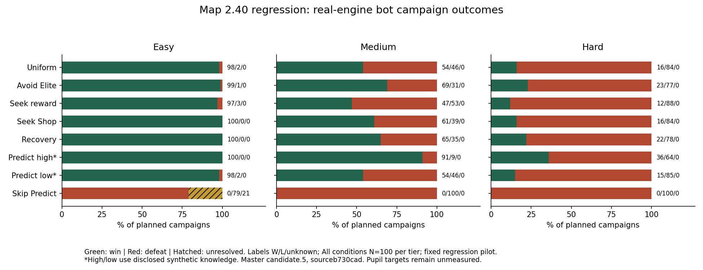

# Map Balance v1.5 — handoff2.40 kepada Master

24 Oktober2026. Repository unDead41/slay-the-math-v2; penerbitan hanya `balance/map`. Master SOR1.2.0.

**VALID untuk integriti data dan keserasian sumber yang dinyatakan. CP PROVISIONAL; target murid BELUM DISAHKAN.** Primary [v1.4](MAP_BALANCE_V1_4_HANDOFF.md) sudah diterbitkan pada8606616a475f21cc95bc5e4fc202c8914498bd78, dengan12,186 rekod candidate.4/game2.37.0. Regresi ini berasingan; jangan pool atau melabel semula data lama.

## Konteks tetap

Cartridge Master opt-in, mode Challenge. Main dipin `b730cad0cb27b53ffbdf687d8fc9edaed143ef43`, game2.40.0, canonical Master `master-1.5.0-candidate.5`. Definition `fab0fec8c7580cb3fb7e79277505f8aca9c30f6e8c2739c83d8ccecd8a88bea7`; engine `710ec84957a00f028d5051d91ce4329a18a8913dbbc4250561a80a037194ef17`. Tiada input pengeluaran diedit oleh Map; integrasi branch mengekalkan sumber main tepat.

[Protokol](../tools/balance/map-regression/README.md) menetapkan100 seed, semua lima polisi laluan feedback sekali/seed serta Predict high/low/skip sekali/seed menggunakan recovery:800 campaign/profile,2,400 jumlah. Feedback Predict menggunakan semula recovery. Satu actual uniform entry/seed/stage dimainkan pada nominal easiest/median/hardest, sehingga1,800 stage replay. Had100 turn/500 paid plays/10,000 API/120 saat task;2 worker/profile,6 agregat. N1 ialah pilot regresi; kajian candidate.4 berulang kekal sejarah. Tiada resampling selepas hasil atau penggantian censor/loss.

Starter12: Rune Strike3, Weak Point3, Rune Guard2, Flash Ward2, Quick Study1, Read Ahead1. Base HP/Gold Easy70/100, Medium65/80, Hard60/70; Focus permulaan combat1/0/0. [Input runtime](../reports/map-balance/v1.5/runtime-inputs.json) menyimpan profile, deck, template musuh dan identiti. Profil, starter, newRun HP/Gold serta template musuh sepadan dengan v1.4; definisi kad dan engine berubah. [Delta binding](../reports/map-balance/v1.5/runtime-definition-delta.json) merekod16 field: mekanik Last Page draw1+2 empty →2+1 empty, Recall1 →0 Energy, serta penerangan berkaitan; Mana Barrier Master berubah teks sahaja dan semua definisi artifact sama. Entry selepas starting-artifact adalah sebenar; gagal artifact dibenarkan. Same-entry triplet menyamakan HP/deck/artifact/RNG/clock dalam profile; Stage2 hanya survivor sebenar.

Combat/acquisition ialah visible greedy/feedback yang sama; routing menggunakan edge/kategori/HP/Gold sahaja. Feedback memilih jawapan terlihat yang belum dicuba sehingga settlement dua salah. High/low ialah model sintetik canonical-key85%/25%, satu Predict attempt; Mystery/artifact feedback. Skip meniadakan Predict/seal progress dan Predict-earned Focus sahaja; Focus asal/Passive/artifact kekal. Ini bukan kesan kausal Focus sahaja atau kemampuan murid. Jam1 saat/jawapan bukan masa membaca murid.

CP pembangunan: p=(W+0.5)/(N+1); CP=1000 ln(1/p)/ln(1/0.70), Wilson95 daripada W/N. Nilai ini terikat pada policy/difficulty/runtime/entrypopulation; bukan kuasa satu kad atau ICP/CCP. CP null jika tiada entry atau scope belum resolved. N1 menghasilkan ketidakpastian sangat luas: satu win memberi CP806.567 dan satu loss CP3886.716 pada formula ini, jadi skor point tidak memberi ranking halus antara seed dengan outcome sama. Gunakan HP/recovery/boss-entry untuk triage, kemudian tambah ulangan current-runtime sebelum ranking akhir. Nominal pressure rank ialah rujukan lama, bukan ramalan damage candidate.5; point inversion tidak menukar rank secara automatik. CP kekal di luar menu/map/HUD/UI pemain.

## Keputusan dan audit akhir

Semua2,400 campaign dan1,683 matched stage replay lengkap: **4,083 rekod**,0 engine/policy error dan0 invalid. Verifier bebas PASS semua profile; Easy score gate FAIL hanya kerana21 skip-Predict censored, Medium/Hard PASS. Censor bukan loss dan scope unresolved kekal CP null.

| Polisi — N100 setiap profile | Easy W/L/C | Medium W/L/C | Hard W/L/C |
| --- | ---: | ---: | ---: |
| Uniform | 98/2/0 | 54/46/0 | 16/84/0 |
| Elak Elite | 99/1/0 | 69/31/0 | 23/77/0 |
| Kejar reward | 97/3/0 | 47/53/0 | 12/88/0 |
| Cari Shop | 100/0/0 | 61/39/0 | 16/84/0 |
| Recovery | 100/0/0 | 65/35/0 | 22/78/0 |
| Predict high sintetik | 100/0/0 | 91/9/0 | 36/64/0 |
| Predict low sintetik | 98/2/0 | 54/46/0 | 15/85/0 |
| Skip Predict | 0/79/21 | 0/100/0 | 0/100/0 |

Semua200 snapshot kekal tepat; semua5,500 laluan dienumerasi secara struktur. Laluan unik yang benar-benar dilawati sampai sepuluh node dalam mana-mana batch: Easy1,120/5,500, Medium974/5,500, Hard731/5,500. Ini coverage lawatan, termasuk kematian di boss; bukan bilangan kemenangan dan tidak dijumlahkan antara profile.

Bank entry Stage1 ialah100/profile; Stage2 ialah100/95/66. Medium5 seed dan Hard34 seed tiada uniform survivor entry Stage2, maka tiga rank CP masing-masing kekal null. IDs penuh ada dalam matched-route-summary/entryAvailability; jangan gantikan dengan state rekaan. Same-entry comparison hardest minus easiest: Easy Stage1 0/100, Stage2−10/100; Medium−12/100 dan−24/95; Hard−42/100 dan−21/66. Semua ialah paired win differences, bukan pooled CP. Nominal rank point inversion:0/3/8 map bagi Easy/Medium/Hard; N1 tidak mengesahkan susunan akhir.

46 map forced-Elite dan62 map tanpa Rest sebelum9 kekal. Pada Stage2, kematian sebelum Rest dalam kumpulan tanpa early Rest: Easy0/130, Medium37/122, Hard57/88 feedback route-policy arrivals. Dalam forced-Elite:0/120,24/111,35/75. Kumpulan bertindih, arrivals mengulangi seed merentas lima polisi, dan survival Stage1 menentukan populasi Stage2; angka ini deskriptif, bukan kesan kausal atau sampel murid bebas. Mystery penalties/recovery windows disimpan berasingan dalam CSV/JSON.

Risiko/reward sebenar pada Hard, **hanya pemain yang sampai ke boss Stage2**:

| Polisi | Boss entries | Purata HP masuk | Upgrades | Artifact dimiliki |
| --- | ---: | ---: | ---: | ---: |
| avoid-elite | 45 | 35.76 | 1.49 | 3.20 |
| health-recovery | 42 | 38.88 | 1.83 | 3.79 |
| seek-reward | 16 | 33.38 | 5.31 | 5.56 |
| seek-shop | 34 | 33.74 | 2.12 | 4.15 |

Kejar reward menghasilkan lebih banyak upgrade/artifact dalam kumpulan survivor ini, tetapi hanya16 boss entries berbanding45 bagi elak Elite. Jangan menyamakan keuntungan survivor dengan manfaat kausal Elite. Deck/Gold/pembelian/Rest/upgrade yang dilepaskan dan state boss setiap stage ada dalam policy-stage-summary, risk-reward dan raw rooms.

Perbandingan runtime menggunakan tepat2,400 pasangan repetition0/task/seed/runSeed yang sama daripada v1.4 dan v1.5. Contoh: Medium recovery72→65 wins, Hard Shop21→16, Hard high-Predict41→36, semuanya N100. Hard Shop mempunyai5 pasangan old-win→new-loss dan0 sebaliknya. Tiada CP delta daripada N lama yang berlainan dikira. Perubahan ialah gabungan kad/resolver/behavior/RNG exposure; ia tidak membuktikan satu kad ialah puncanya. [Semua pasangan dan provenance](../reports/map-balance/v1.5/paired-runtime-summary.csv).

## Semakan dan fail berubah

- `npm test --ignore-scripts` selepas build:999/999 PASS,0 fail/skip pada source6c97942/game2.40.0. `npm run check` dan `npm run test:maps` PASS;200 unique layouts dan12 hash PNG sepadan.
- Build production PASS,254,378,892 bytes; alat/data Map balance dikecualikan. Diff protected runtime, package, Master/Card, generator dan seed registry terhadap mainb730 kosong. Build sementara dibersihkan selepas pemeriksaan.
- Verifier bebas:4,083 raw records,705,975 child CSV cells,1,800 matched-score rows dan60 source/input hashes setiap context; parent enam jadual/127,281 CSV cells turut disemak. Semua task/entry/scope/CP/Wilson/null/bounds sepadan. [Indeks bukti](../reports/map-balance/validation-v1.5/validation-index.json).
- Arkib sumber65 fail,2,023,606 bytes, SHA-256 `528e092cb8a76aa566bcfcf29664741c2ae5e40b062fc9374d7bf00ca2633a5e`. Restore baharu memadankan ketiga-tiga context dan3/3 full primary trials tepat. Ini replay pengesahan,0 sampel bebas tambahan. Arahan ada dalam README regresi.
- Semua2,873 rekod lengkap sebelum ENOSPC kekal dengan hash sama; semakan turut menangkap3 Easy dan1 Medium matched records yang belum persisted selepas resume. Hanya empat ID tepat itu dipulihkan dengan satu worker dan context yang sama. Semua rekod lengkap semasa checkpoint1397/1384 turut kekal. Data sejarah v1.4/v1.3/base mempunyai tree Git yang sama dengan8606616.

Map-authored changes: optional additional protocol fingerprints pada `map-advanced/experiments.cjs`, ujian identity kanonik penuh (dua assertion candidate.4 RED→8 contracts GREEN), driver/config `map-regression`, reports/validationv1.5, SOR04, audit/handoff, indeks, keputusan dan changelog. Fixed config pinb730/candidate.5, lima route +tiga Predict cases/seed, satu matched entry, grant boss akhir0 dan had asal. Tiada stat kad/musuh/harga/loot/topology/save/UI ditune oleh Map; perubahan production daripada main dikekalkan tepat.

## Cadangan kepada Master

1. Ulang current-runtime dengan beberapa entry/seed sebelum memuktamadkan ranking. Ini menambah ketepatan dan mengisi bank Stage2 yang kosong; kekalkan matched HP/deck/artifact/RNG, had dan semua loss/censor. Jangan label N1 sebagai ranking final.
2. Utamakan semakan recovery sebelum encounter bahaya dalam46 forced-Elite/62 no-early-Rest maps, terutama selepas penalti Mystery. Cadangan akses recovery atau pampasan Elite perlu diuji dengan owner Combat/Economy sambil mengekalkan kontrak map; perubahan boleh mengurangkan tekanan tetapi turut mengubah peluang upgrade/reward. Tiada calon nombor diaktifkan di sini.
3. Triage lima Hard-Shop regressions dan trajektori Medium recovery melalui paired-runtime-cases sebelum tuning lanjut. Keuntungan deck tidak menjamin kelangsungan hidup; bandingkan state boss serta laluan/ganjaran penuh.
4. Kekalkan diagnosis Predict/seal berasingan daripada Focus tulen; gunakan profil Combat/Master dan playtest murid sebenar bagi target90/70/50. Setiap perubahan input memerlukan versi/context/output baharu, verifier dan perbandingan yang jelas.

## Had dan handoff

Target murid Easy90%/Medium70%/Hard50% kekal BELUM DISAHKAN dan milik Master. Pengesahan integriti tidak bermakna balance diluluskan. Batch tidak menguji semua kemungkinan RNG/deck/polisi pemain, semua77,384 pasangan route melalui engine, peranti/hosting atau kesan bantuan soalan terhadap murid. Tiada semakan visual/model atau kandungan matematik baharu.

`shopGoldSpent` mengekalkan jumlah penurunan Gold bersih setiap tindakan; paid Purse boleh mengimbangi bayaran. Jangan tafsir sebagai gross quote. Net room/final Gold dan CP kekal tepat. Cadangan Economy2e54 mengenai gross-flow observer serta Combat3a623 mengenai forced-owned Spool sensitivity diserah kepada Master; tidak dicantumkan secara senyap ke dalam protokol beku ini. Sebarang tuning kad, musuh, harga atau topology memerlukan keputusan domain/Master dan cohort baharu.

## Nota pemulihan pelaksanaan

ENOSPC menghentikan penulisan tiga journal. Semua2,873 rekod lengkap disahkan hash dan disimpan; tiga suffix JSON yang terputus diasingkan bersama salinan shard asal sebelum dibersihkan. Resume menggunakan context/task/seed/runSeed/limits yang sama, hanya bagi ID yang belum tersimpan. Fail retention-before/after membuktikan setiap rekod lengkap sedia ada kekal, termasuk semua loss/censor. Ini pemulihan data persekitaran, bukan penukaran hasil game. Raw sejarah v1.4 kekal penuh dalam Git/remote; hanya materialisasi145 fail tempatan diketepikan selepas pengesahan blob bagi mengosongkan ruang. `elapsedSeconds` mencerminkan invocation terakhir, bukan masa keseluruhan pengumpulan.

## Resit penerbitan

Kandungan penuh diterbitkan pada **`d13c7758b7580bbb10d352fbb9388f1f87df1032`**, tree **`547d05fb051229697d6273f07281e757b8ea0943`**, branch [balance/map](https://github.com/unDead41/slay-the-math-v2/tree/balance/map). Ordered parents ialah published Map8606616 dan mainb730cad; pinned main ialah ancestor sebenar. Ref dipindah dengan expected old SHA, tanpa force; compare GitHub serta native fetch mengesahkan ref/tree/parents. Main masihb730cad ketika readback dan tidak ditulis oleh chat ini. Commit resit susulan mengubah dokumentasi sahaja; data/runtime yang diuji kekal. [Resit berstruktur](audits/balance-map/PUBLICATION.json).

Persekitaran ujian: Node24.19.0; suite penuh menggunakan jsdom26.1.0 dan sharp melalui NODE_PATH di luar repository. Pure Node engine replay/source verifier tidak memerlukan pakej UI tersebut.
