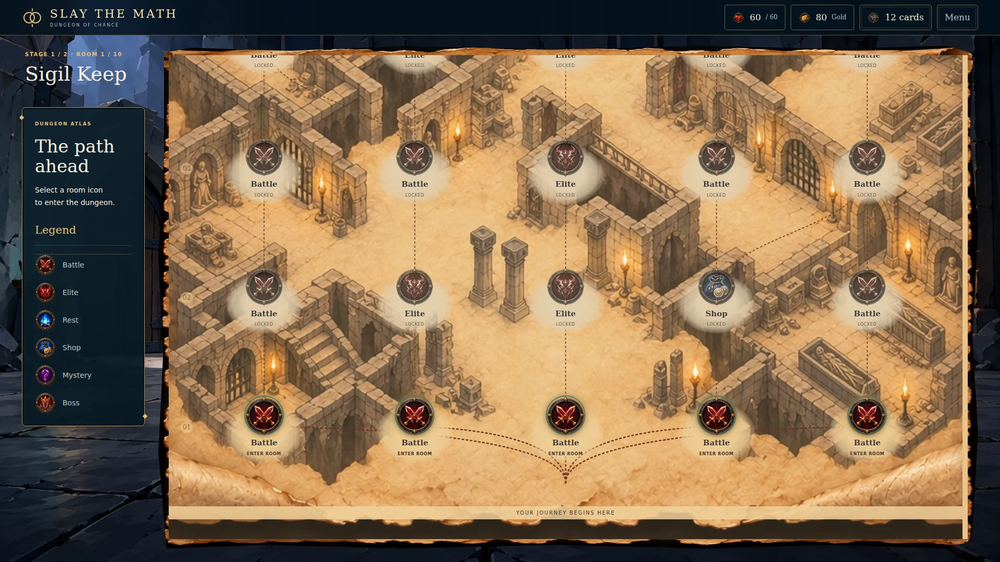
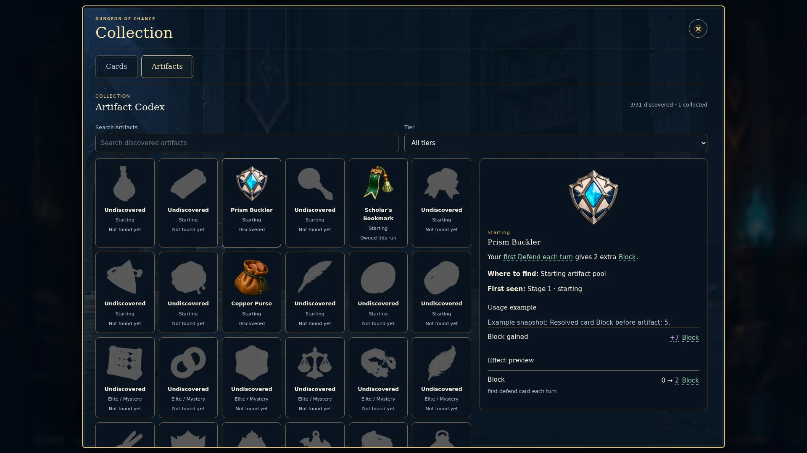
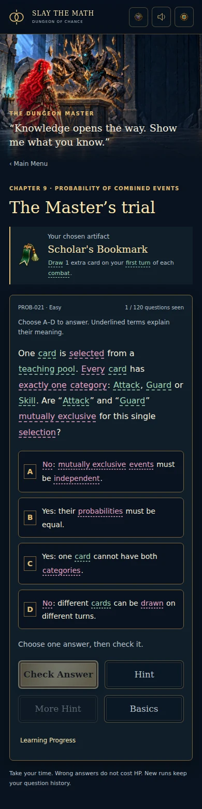

# Map and integrated mechanics — 2.11.0

Ijamm requests the aesthetic in `image(20261021-185345).png` and applying `INTEGRATION.zip`. The map now uses a large worn parchment dungeon, live room seals/dotted routes, a left legend, stage/room title and top run HUD. The existing graph controls still enter the exact legal room; the art contains no baked routes, counts or controls. Both stages and five-level legacy snapshots retain their topology and encounter secrecy.



## Supplied integration

| Package | Applied behavior | Existing owner retained |
|---|---|---|
| Artifact 3.5 | Persistent discovery/collection Codex, search/clear, tier filter, examples/comparisons and live counters/activation pulse | `artifacts.js` / engine effects and acquisition; current 31 icons; native Collection/dialog/toast |
| Question Bank 1.5.0 (content 1.4.0) | 120 questions, 360 specific wrong-choice feedback entries, Hint/More Hint, 240 hint/solution visuals, 360 worked steps, 7 Basics modules / 14 unscored checks, 30-skill evidence and adaptive selection | `education.js` host adaptation; synchronous final correct-and-Claim engine transaction |
| STM_SHARED 1.0.0 | One math/game/calculation help hub with keyboard, pointer, touch and Escape | Existing palette and resolved `calculationState` snapshots |

All 120 original IDs, seeds, prompts, choice IDs/text/labels/order and correct keys match pre-integration main. All 31 artifact triggers/values are unchanged. Supplied PNGs match retained WebPs in visible pixels and alpha; WebP can discard RGB under zero alpha. The two unsupported Passive/card-driven Discard items remain outside offers. Nine engine-dependent glossary definitions are explicitly reconciled (Focus, Block, damage, Strength, Agility, Defense, Passive, Draw and d6). All category renderers share the resulting registry lock.

The selected original modules/data remain in `modules/mechanics/source`. `npm run import:mechanics` deterministically builds the committed classic bundle without dependencies. The supplied pure learning reducers are used inside the current synchronous engine; the asynchronous public facade is exported but not instantiated as a second owner. The automatic engine-wrapping adapter is not loaded because its ownership fields differ from this game. Duplicate PNG/4K sheets, PDF previews and demo hosts are excluded.



## Learning and compatibility

Hint must be read before a later wrong submission unlocks More Hint. Earlier wrong answers do not retroactively unlock it. Answer calculations, worked solutions and solution diagrams are gated until correct. There is no reveal shortcut through Claim Artifact. Basics practice is explicitly unscored and never awards HP, Gold, Focus or assessment credit. Skill rows describe local practice evidence; fewer than three completed items remains “Building evidence”.

Answer selection uses the visible A–D native button; underlined terms are separate help buttons and never select an answer. Term and answer controls are siblings, including inside long rich choices. Collection tabs retain focus across rendering and support Arrow/Home/End; the native tier popup is intentionally platform-owned. Long trial/Basics/Codex content uses the existing document/dialog scroll owners. The combat artifact rail sits within existing resource space.

Run version 1 and old educationState remain supported. Existing pending IDs, shuffled choice order, selection and attempts resume. New reservations freeze supplied source order and use the supplied adaptive/dedicated RNG. Following its session contract, New Run resumes an unfinished question reservation; completed questions stay outside the draw pool. Import unions exposure IDs into the exportable run as well as the profile, and closed profile evidence cannot be downgraded by a stale pending fork. Imports remain bounded (2 MB). The final Claim still applies ownership/effect/progression once.

Old saves do not contain trustworthy ordered support events or complete skill evidence. Migration preserves exposure/current answers, treats prior wrong attempts as preceding a legacy Hint and invents no historical mastery. The current run carries its canonical evidence and all known exposure IDs; the same-origin profile retains closed evidence across runs/imports. Corrupt question/Codex history is preserved with visible feedback. Optional `stmArtifactUI` is derived display state; gameplay never uses it to award resources.



## Artwork provenance

Built-in `imagegen.imagegen` produced the decorative map plate from the supplied composition: tall worn parchment, sepia isometric dungeon architecture, broad paper areas, ragged/rolled edges; no characters, interface text, HUD, nodes or route marks. Native output is 1024×1536. WebP quality 94 retains native dimensions; this is not a 4K generation. Runtime workspace path: `dist/assets/map-dungeon-parchment-v2.webp`. Reference/source/runtime hashes and the prompt summary are in `dist/assets/map-atlas-art.json`.

## Actual verification

- Game Node/DOM: **148 passed, zero failed/skipped**, including exact-once Claim, old saves, corrupt history, fork merging, exportable exposure union, genuine card-driven counters and delayed dialog focus.
- Supplied suite: verifier passed; **126 Node + 39 Python tests passed**.
- Map module: **7 passed**; validator checked **100 seeds / 200 distinct stage layouts**, source PNG hashes and SOR files.
- Chromium: **8 viewport sizes**, from 320px phone to 3840px/4K and ultrawide; left legend, no page overflow, native keyboard entry and live graph state. Additional Stage 2 and five-level legacy fixtures retain their route/floors and enter by Space.
- Chromium rich content: **all 120 questions, 360 wrong feedback entries, 120 More Hints, 240 hint/solution visuals and worked solutions** rendered without unsafe markup/reveal errors. Real trial/Basics/progress/Claim and Codex search/clear/tier/comparison/tab/tooltip flows passed.
- Generated portable HTML: actual `file://` trial/support/Claim/map/combat/Codex passed with **zero HTTP or dependent local asset requests**.
- Build/syntax passed. Strict premium UI audit scans the maintained `dist` source: **38 files, zero errors/unresolved**. Official `designmd lint`: **zero errors/warnings**.

Machine evidence: [release report](verification/map-integration-2-11.json), [browser matrix](verification/map-integration-browser-2-11.json), [complete learning renderer](verification/map-integration-learning-final-2-11.json), [Stage 2/legacy](verification/map-integration-routes-2-11.json), [offline](verification/map-integration-offline-2-11.json), [strict UI audit](verification/map-integration-premium-2-11.json). Input/output reconciliation: `modules/mechanics/integration-audit.json`, `question-alignment.json` and `icon-alignment.json`.

These are Linux/Chromium/jsdom automated checks, not physical-device, Windows, Safari or Firefox tests. The accepted Alyssa/Normal/Elite animation registry, assets and player remain unchanged; no unavailable MODEL.zip integration is claimed. Hand limit/debounce and result timestamp regressions pass in the game suite. The generated large portable HTML is not part of the source commit; rebuild it after pulling.

```bat
cd "C:\Users\ijmah\Desktop\slay-the-math-v2"
git pull --ff-only origin main
npm.cmd run build
npm.cmd start
```

Stop an old server with Ctrl+C, then use Ctrl+F5 at localhost:4173. Rollback to the previous source baseline is main commit `8e5ae698441a194ad296ec90c7e66d466297b56b`; export before deliberately using an older runtime with a new learning session.
