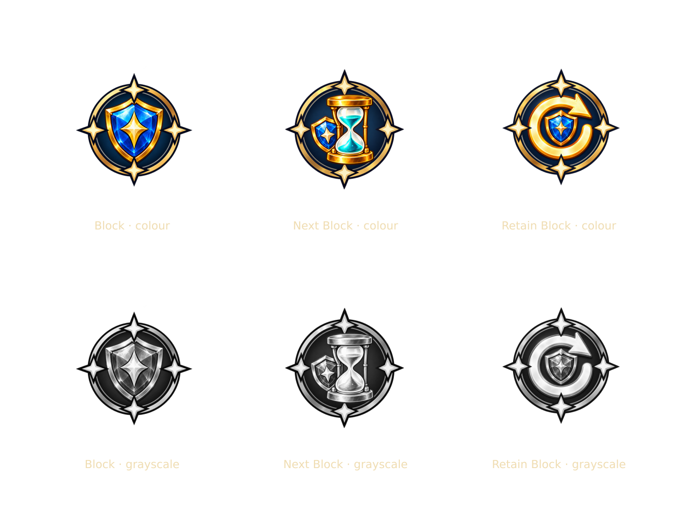
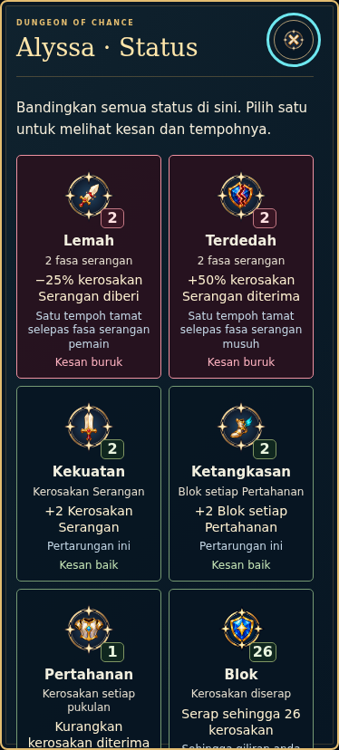

# Explained status icons — 2.38.0-icons.1

24 October 2026, Asia/Kuala_Lumpur. Ijamm accepts all six follow-up proposals and requests an update on the assistant's branch. This is a **branch-only preview** on `codex/icon-clarity-audit`; no new main publication is authorized.

Work starts from main `990541d57c6df96cefb21eddc7a365d1d989a74d` / 2.37.0, then incorporates documentation-only main `6376a222169815af582cf55aa4794f3c809a3515` / Master SOR 1.2.0 before final verification. The original remote icon head was `b18c4c99d28530026f8d90d28964569c2f7af610`, already merged into main. The existing branch advances from those current owners; it does not copy its earlier game version over main.

## The six requested improvements

| Request | Implemented scope |
| --- | --- |
| Explain numeric units and duration | Inline Weak/Vulnerable show configured percentage plus remaining phases. Overview/detail separate value, unit, short effect and exact timing. Archived saves show their real flat-hit amount/stacks, never current percentages. Strength wording follows the card preview because ordinary/Master multi-hit allocation differs. |
| Complete BM status language | `DCCombatStatus` owns ten bilingual names, short effects, units, timing and full descriptions, plus status-panel/control labels. VFX numeric labels call this same name owner. Existing Settings language remains authoritative. |
| Readable phone labels and Normal/Large | Inline labels/units are at least 12 CSS px; Large uses 14px and larger status art. The preference lives in existing UI settings, survives reload and changes status components only. Local scrolling retains access to every effect. |
| Distinct Block-family silhouettes | Three built-in imagegen edits emphasize a single broad shield, a dominant hourglass and a dominant circular return arrow. Original V1 files remain intact. Other seven status pictures and original card/artifact art are unchanged. |
| Brief effects in the comparison panel | Every entry shows a sentence describing its actual effect plus its timing. Retain Block explicitly keeps unused Block up to a cap; Next Block grants its saved amount at next turn start. Details keep canonical full wording. |
| Slow/broken-image handling and priority | `DCIconReadiness` reserves named usable controls while images load, supplies local semantic SVG fallbacks on image error, and exposes a bounded list of ten status plus five HUD assets for Publish Handler. No download screen, service worker, persistent cache, scene deadline or gameplay state is introduced. |

`dist/combat-status.js` reads the current run's rule owner; it never changes combat. Negative values remain signed. Queued values are already resolved by the engine, so presentation does not add Agility/Focus again. Status inspection and display-size changes preserve saved gameplay. The distinction between current and archived rules is tested rather than inferred from game version labels.

## Artwork, transparency and exports

The selected source images were created with the built-in `imagegen` edit tool using the three installed V1 status files as references. Exact prompts and generated file identities: `references/status-polish/inputs.json`. Native PNGs are **1254×1254**, not native 4K. Their bytes are retained as generated.

`tools/export-status-variants.cjs` makes aspect-preserving alpha-bound exports: runtime 512×512 lossless WebP with 40px transparent outer strips; 1080×1080 PNG with 100px outer padding; and **4096×4096 transparent lossless WebP with 100px outer padding**. The 4096 exports are resampled and do not add native detail. `references/status-polish/manifest.json` records dimensions, source/runtime hashes, bounds and silhouettes.

Only the small runtime derivatives enter `dist`; raw sources/high-resolution exports remain outside the production player. `tools/build-status-variants.cjs` applies exactly three reviewed overrides to the icon registry and metadata. Ordinary builds and explicit icon-package imports preserve these approved overrides while retaining the original card/artifact owners. The original package manifest remains an audit of its original, retained files.

## Loading integration

`DCIconReadiness.criticalAssets()` exposes fifteen unique relative resource URLs for the existing Publish Handler work. `warm()` resolves embedded portable bytes when available, otherwise requests those small icons at high priority. Warming is deduplicated and never blocks input or starts a game timer. A MutationObserver plus native load/error events cover subsequent UI/modal renders.

Fallbacks are self-contained semantic SVGs. They do not issue another image fetch, retry recursively or replace card/artifact illustrations. The normal visible label/count and accessible control name stay present. This implements icon readiness within this branch's scope; the wider staged/background-download flow stays with Publish Handler.

## Verification and audit

Fresh evidence: [integration.json](verification/status-icon-polish/integration.json) and [branch audit](audits/icon-clarity-audit/LATEST.md).

- **932 full serial tests passed, zero failed/skipped.** A later CSS-only correction improves short-landscape placement; all final runtime JavaScript bytes still match the full-suite snapshot. The final focused run passes **34 tests**, zero failed/skipped; the earlier broader UI run passes 118. Snapshots/logs distinguish these runs.
- `npm run check`, changed-script syntax and the final production build pass. All **84 runtime resources** match production, allowing the unchanged Dev-access app projection. All sixteen current tutorial images and 85 source-input hashes match.
- Actual production browser checks cover **24 language/size/viewport combinations** across 1920×1080, 1280×720, 390×844, 320×740, 844×390 and 3840×2160. Names/units are at least 12px, targets at least 44px, counts/effects stay canonical, and badge text/page layouts do not overflow. Intent stays above the enemy status panel. Normal/Large persists with unchanged saved gameplay and card geometry.
- A real deferred Block response retains a named usable control and then becomes ready. Four intentional HTTP 404s decode local semantic SVG fallbacks while labels/counts/details remain available. The portable file embeds the new variants/BM explanations/Large preference with zero HTTP requests.
- The existing **41-state** icon regression, complete **17-chapter/11-practice** tutorial browser checks, production static-subpath Developer Hub and **10-check VFX** browser suite pass. VFX covers three viewports and all three Master difficulties, exact gameplay/save equality, modal/reduced-motion lifecycle and offline use.
- Native image checks verify three source/runtime hashes and transparent outer strips on all runtime/1080/4096 exports. The comparison below is a deterministic QA sheet of the actual runtime files, not a game screenshot or a redraw.

The VFX regression exposed an actual layout interaction at 844×390: stacking a taller status rack below HP left its aura above the arena. Short landscape now places HP and the rack side by side, retaining card/arena dimensions; intent anchors above the panel instead of covering it. Before-failure evidence is retained alongside passing final reports. No VFX/combat numerical fix was needed.

Actual pupil glance recognition and physical Windows/mobile behavior remain unmeasured. A grayscale preview checks visible differences; it does not establish user recognition rates. No live Google deployment or public main deployment is part of this branch update. MODEL.zip was unavailable and is not used; PDFs are unchanged.
