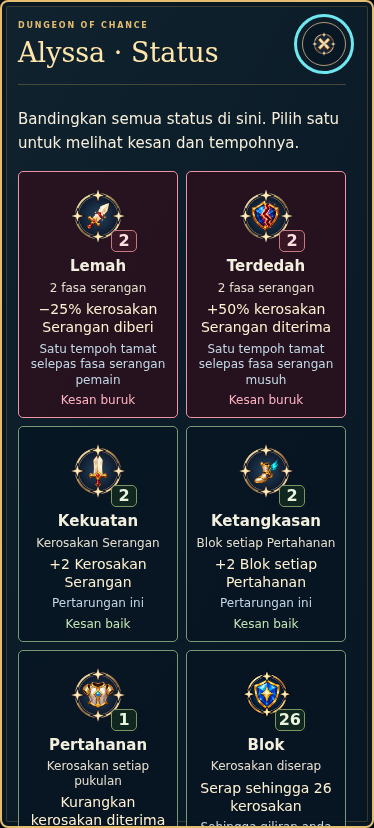
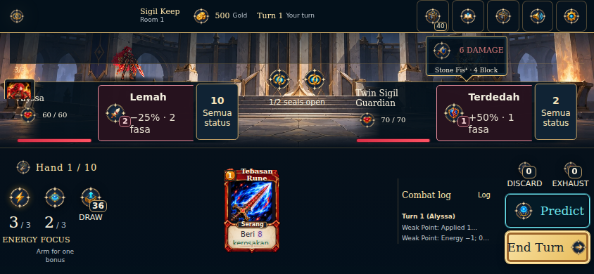

# Explained status icons — main2.39.0

24 October2026. Master SOR1.2.0 and current main/feature audits read before this
integration. Ijamm explicitly requests pushing all six approved icon improvements
after the education release. This supersedes the earlier preview-only boundary.

## Exact inputs and initial audit

Main first parent:cb1bbcf688d9556b55bc8fe5522b5b652309640c (2.38.0).
Icon second parent:81533b38b8c7be1d897c3acc282f749df9beaeab (2.38.0-icons.1).
The education release is already published and independently verified947/947.
The icon preview had its own932-test run; these counts are historical and do
not replace the fresh combined-tree verification below.

Actual conflicts: generated launchers/release/package, four derived tutorial
images plus screenshot manifest, and append-only SOR10/15/CHANGELOG/DECISIONS.
Keep both SOR histories and merge package checks/test commands from both owners.
Retain the education HTML script/style list and insert icon-readiness after the
icon registry. Regenerate version/cache pages and all16 actual tutorial pictures
from the combined2.39 UI. The game app and mechanics importer merge directly;
inspect and test their combined report/status paths instead of replacing either.

## The six approved changes

| Feature | Integrated behavior |
| --- | --- |
| Units and duration | Show actual current percentages/remaining phases, or archived flat-hit amounts, from the run's rule owner. |
| BM/English | One owner supplies ten status names, short effects, exact timing and detailed descriptions; VFX uses that owner. |
| Normal/Large | At least12px labels and a stored14px Large preference for status presentation; card/arena geometry remains independent. |
| Block-family pictures | Single broad shield, dominant hourglass and circular return-arrow variants; all original V1 files remain. |
| Comparison explanations | Each active status shows its real short effect and timing, with full details available. |
| Slow/failed images | Keep named usable controls, bounded15-icon priority warming and local semantic SVG fallbacks. No broad download screen/cache ownership is added. |

Three native1254px generated source PNGs and the approved512/1080/4096 exports
are integrated byte-for-byte from the feature. The4096 exports are resampled;
no native4K-detail claim is made. Full provenance/hashes/padding remain owned by
references/status-polish/manifest.json. Original card/artifact art, seven other
status pictures, hero/enemy motion and audio remain intact.

## Cross-module findings and handling

| Category / ID | Priority / confidence | Evidence and result |
| --- | --- | --- |
| MASALAH DISAHKAN / INT-239-01 | P2 / high | Both branches changed generated release lists/package checks and tutorial snapshots. Taking one complete side would drop report scripts or readiness. Merge the source declarations/check commands, then regenerate all output. |
| RISIKO BERPOTENSI / INT-239-02 | P1 / medium | Larger status labels/short-landscape placement interact with arena VFX and intent. Mitigated by passing real24-state display checks and the ten-check VFX suite on the combined tree. No numerical fix is inferred from artwork. |
| RISIKO BERPOTENSI / INT-239-03 | P2 / medium | Broader future Publish Handler work should consume the bounded critical-icon owner and avoid duplicate fetch schedules; no unrelated preloader is activated here. |
| PENAMBAHBAIKAN / INT-239-04 | P2 / high | All six user-selected changes are integrated after education, preserving direct reports, private triage, reviewed hints and Settings-only Developer access. |

Existing DOC-001/DOC-002 in the main documentation audit remain out of scope.
MODEL.zip is unavailable; this task merges approved icon sources and preserves
installed models without claiming model-reference review. No new design,
mathematical rule, balance, storage identity or learner consent change is added.

## Verification

Status: VALID within this integrated UI/education scope. Fresh frozen-runtime
serial suite: **956/956 passed**, zero failed/skipped. Native checks passed24
production language/size/viewport states with real deferred/404 fallback cases
and portable mode;10 VFX checks across three viewports and all three Master
profiles; six Result-report flows/18 geometry states; eight Google offline/ACK
flows; complete tutorial/portable; production/static and local Settings-only Dev
access. Production/syntax builds passed. All16 fresh tutorial images/88 input
hashes,87/88 launcher resource hashes and712 production resources match.
Education owners and four report/forecast app functions match main2.38 exactly;
icon owners match81533b3.606 original asset files remain unchanged, with only the
intended status metadata update, new three approved variants and derived tutorial
captures. No additional blocking issue found in the scoped final diff.
[Structured fresh evidence](verification/status-icon-main-2-39-0.json). Recheck the main lease before
moving the ref and verify exact ordered parents/tree/version/ref afterward.
Physical-device/pupil recognition and live Google deployment remain unverified.
The education receiver update is still an owner action, as described in
[the Google guide](education/GOOGLE_ISSUES.md).

## Run main on Windows

Stop the previous server with Ctrl+C. In the project folder:

```powershell
git stash push -m "backup-before-main-2.39"
if ($LASTEXITCODE -eq 0) { git fetch origin }
if ($LASTEXITCODE -eq 0) { git switch main }
if ($LASTEXITCODE -eq 0) { git pull --ff-only origin main }
if ($LASTEXITCODE -eq 0) { npm.cmd start }
```

Open http://localhost:4173 and check2.39.0. Settings owns language, status display
size and Developer access. Inspect active statuses in combat or the comparison
panel. Education Practice and the Result report control remain available.

## Actual combined-game screenshots




