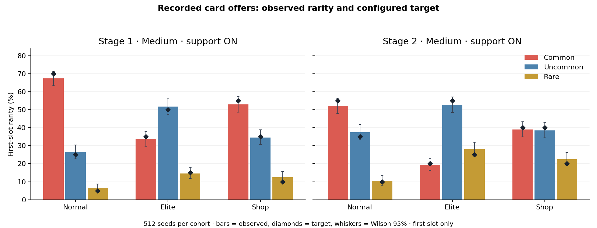
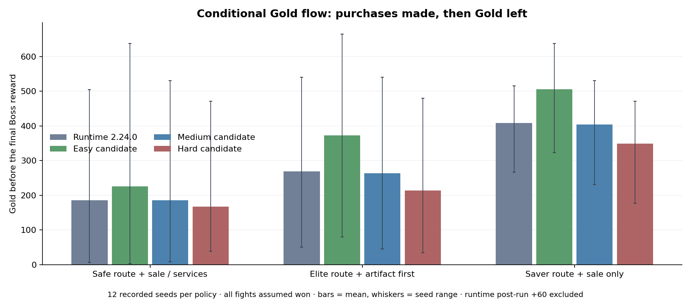

# SOR Economy, Loot & Rewards — Slay the Math

Versi calon: **economy-1.2-candidate.1** · 23 Oktober 2026 (Malaysia). Branch: `balance/economy`. BASE_COMMIT: `2800f9aeba5ed594e6ef3f991bcf4dfa498a5de7` (game 2.24.0).

**Status:** aturan skop daripada Ijamm ialah DISAHKAN. Angka tuning ialah **CADANGAN yang sudah diimplementasi sebagai eksperimen opt-in dan diuji**; belum calibrated. Runtime/default dan save tanpa `economyState` kekal baseline. Ini belum menjadi difficulty tempur penuh v1.2. Sasaran 90%/70%/50% murid menang dua boss ialah sasaran Master; tiada data murid atau nilai CP terukur dibekalkan oleh kerja ini.

## 1. Pemilik dan input

- `dist/economy-data.js`: satu config versi untuk ekonomi, profil, harga, rarity dan requirement tags; merekod SHA-256 spesifikasi Balance v1.2.
- `dist/economy.js`: quote, private loot RNG, receipt/snapshot, bounded weighting dan event adapters.
- `dist/engine.js`: transaksi Gold/deck, Shop, Normal/Elite rewards, Rest, Boss, checkpoint/retry dan validasi run.
- `dist/artifacts.js`: pemilikan/acquisition unik, hadiah dan semua kesan artifak asal. `dist/mystery.js`: deadline, satu attempt, pilihan/kos/settlement event.
- Combat, question bank, map generator dan data stat asal ialah input. Sepuluh fail input berhash sama dengan BASE_COMMIT: [bukti](evidence/unchanged-input-hashes.json).

Audit fakta runtime dan jurang: [AUDIT_RUNTIME.md](AUDIT_RUNTIME.md). Rujukan angka/prosedur: SOR Balance v1.2 BAL-21–28 dan CP-11–16. Pakej asal disediakan terhadap af12035 (2.23.1); audit ini menggunakan base baharu yang diminta, bukan menganggap dokumen ialah kod runtime.

## 2. Kontrak tawaran mengikut sumber

**ECO-01:** Starter 12 kad tetap yang sama. New Challenge menawarkan tiga artifak Starting eligible/unowned, pilih satu melalui flow pendidikan asal. Learn tidak menerima hadiah opening baharu. Starting artifact uniform dalam tier; bukan weighted rarity kad.

**ECO-02:** Normal: tiga ID kad distinct, pilih satu atau Skip. Elite: tiga distinct, instance hadiah upgraded, pilih satu/Skip kemudian flow artifak. Tiada Passive dipasang percuma; had tiga Passive aktif ialah domain Combat dan tidak menghadkan jumlah Passive yang dimiliki dalam deck.

**ECO-03:** Shop mempunyai **enam kad unik dan tepat satu sale 60%**. Bukan enam tambah satu. Shop sekarang menjual instance biasa; formula upgraded ×1.20 tersedia untuk pemilik sumber yang menjual upgraded. Stok artifak ialah 3 Starting / 2 Mid / 1 Boss; slot Boss Stage 1 dikunci dan tidak diganti. Stage 2 membenarkannya. Pool habis meninggalkan slot kosong, tanpa reroll/duplicate.

**ECO-04:** ME03 kekal Skill-only. ME12 menawarkan hingga tiga kad atau Gold mengikut event. ME04 kekal kategori asal, mengecualikan ID asal, menyimpan semua hasil calon sebelum target dipilih dan menetapkan hasil upgrade=0. Boss 1 memberi Gold + artifak Boss eligible + recovery sebelum checkpoint; tiada card-roll tambahan. Boss 2 terus victory tanpa hadiah tempur selepas run. Rest/Explore memberi heal ATAU upgrade satu instance, bukan dua manfaat atau kad rawak tambahan.

## 3. Rarity dan bounded support

**ECO-05:** Tapis eligibility/kategori/ID dahulu. Pilih rarity dengan jadual sumber/stage, renormalize jika tier tiada calon. Pilih ID dalam rarity, buang ID terpilih daripada pool dan ulang. Bilangan kad dalam kategori tidak secara senyap menggantikan rarity weights.

| Pool | Common | Uncommon | Rare |
| --- | --- | --- | --- |
| normal_s1 | 70 | 25 | 5 |
| normal_s2 | 55 | 35 | 10 |
| elite_s1 | 35 | 50 | 15 |
| elite_s2 | 20 | 55 | 25 |
| shop_s1 | 55 | 35 | 10 |
| shop_s2 | 40 | 40 | 20 |

ME03/ME12/ME04 mewarisi Normal pada stage semasa selepas tapisan sumber.

**ECO-06:** `w = stageSuitability × (1 + alpha × supportScore) × duplicateFactor`. Alpha Easy/Medium/Hard = 0.25/0.15/0.10; supportScore 0..1 daripada capability deck/artifak yang benar-benar ada dalam snapshot. Requirement OR dikira satu kali. Kad tanpa requirement mendapat 0; tema/warna tidak memberi bonus.

Duplicate factor: tiada salinan 1.0; satu 0.65; dua atau lebih 0.35; Passive ID sama yang dimiliki 0.15. Setup Passive Growing Flame/Battle Rhythm/Lasting Shield/Grimoire Ward/Ember Core/Clear Mind: Stage 1 level 1–4 =0.85, level 5–10 =1.0, Stage 2 =1.10. Kad lain 1.0. Semua calon eligible kekal berpeluang positif.

Requirement tetap: Shield Shot→Block; sumber Strength→Attack; sumber Agility→Defend; Grimoire Ward→Skill; Ember Core→Focus spender; Lasting Shield/Hold the Line→Block; Recall→kad lain boleh masuk Discard; Last Page→0 Energy ATAU draw/selection; Card Search→kategori sasaran wujud. Tidak membaca susunan Draw tersembunyi. Butiran semua 40 ID: [jadual](tables/rarity_and_weights.md).

**ECO-07:** Tiada ICP/CCP digunakan sebagai angka sebenar. Receipt menyimpan `combatPower:null`, `powerStatus:UNMEASURED`. Skor support ialah kecukupan requirement, bukan kuasa kad. Tiada nerf kad/artifak yang dimiliki ketika run berlangsung. Artifacts uniform tanpa pengulangan dalam tier eligible/unowned; faktor rarity/duplicate/support kad tidak dipakai pada artifak. Hand-discard memerlukan kesan sebenar dari Hand; End Turn dan calon Draw yang dibuang tidak memenuhi syarat. Passive yang dimiliki membolehkan Initiate’s Ring masuk pool yang relevan.

## 4. Harga, Gold dan recovery

[Jadual lengkap profil/pendapatan](tables/profiles_and_income.md), [harga semua 40 kad](tables/card_prices_40.md), [artifak/servis](tables/artifacts_and_services.md).

| Parameter calon | Easy | Medium | Hard |
| --- | --- | --- | --- |
| Gold mula | 100 | 80 | 70 |
| Normal / Elite / Boss 1 | 30 / 50 / 75 | 25 / 40 / 60 | 22 / 36 / 54 |
| Harga Shop × | 0.90 | 1.00 | 1.10 |
| Rest heal | 20 | 15 | 12 |
| Heal selepas Boss 1 | 20 | 12 | 8 |

**ECO-08:** Common/Uncommon/Rare asas 50/75/110 Gold. Artifak Starting/Mid/Boss asas 80/140/220. Formula akhir:

`max(1, ceil(base × upgradeMultiplier × difficultyShopMultiplier × saleMultiplier × (1 − bestOwnedArtifactDiscount)))`.

SaleMultiplier 0.4 hanya pada satu slot. Discount terbaik sahaja; tidak ditambah. Semua perkalian dahulu, satu ceil akhir, menggunakan perkalian peratus integer untuk mengelakkan ceil berlebihan akibat floating point. Contoh Common Easy sale dengan diskaun sebenar 15%: `ceil(50×0.9×0.4×0.85)=16`. Uncommon upgraded contoh sama: `ceil(75×1.2×0.9×0.4×0.85)=28`.

Kadar artifak **sebenar 5%/15%** dikekalkan sebagai input Combat, bukan 10%/20% cadangan pakej. Purse kekal +25, bukan +40. Membeli artifak diskaun mengemas kini quote stok belum dibeli, tanpa menukar ID/sale atau harga resit pembelian terdahulu.

**ECO-09:** Removal berbayar kali ke-n: `50+15×(n−1)` sebelum profil/diskaun. n mengira servis Shop berbayar sepanjang run; removal percuma ME10 tidak menaikkannya. Sekali servis per Shop. Shop dan ME10 mesti meninggalkan sekurang-kurangnya **10 kad run deck**; ini tidak menghadkan zon combat selepas Exhaust/Passive. Gold tidak negatif, deck cap asal 60 dipatuhi; apabila penuh, reward boleh di-Skip.

**ECO-10:** Heal terhad pada missing HP. Rest ialah satu pilihan; heal Boss 1 sekali sebelum checkpoint. Tiada auto-heal Normal/Elite selain sumber jelas seperti artifak. Nilai HP/Max HP mula **60 pada ketiga-tiga eksperimen ekonomi** (+Ration − sacrifice), sebab profil Combat 75/60/55 belum diintegrasi. Semua kesan artifak combat/recovery mengekalkan nilai base dan tidak menerima multiplier heal event.

## 5. Semua 15 Mystery events

[Jadual 45 baris](tables/events_15_by_difficulty.md) menyatakan setiap event pada tiga difficulty. [Data runtime asal](tables/events_current_runtime.json) dan [definisi calon](tables/events_candidate_profiles.json) membolehkan audit tepat.

**ECO-11:** Durasi `ceil(baseSeconds × timeMultiplier)` pada Easy/Medium/Hard ×2/1.5/1. Gold reward `floor(base×1.2/1/0.9)`; Gold cost `ceil(base×0.8/1/1.1)`; heal `ceil(base×1.25/1/0.8)`; voluntary HP cost `ceil(base×0.6/1/1.2)`; failure HP `ceil(base×0/1/1.25)`, nonlethal minimum HP 1. ME15 Max HP cost khusus 3/5/6, tanpa gandaan kedua. ME14 first-turn Energy loss 0/−1/−1; base Energy 3 selepas penalti sekurang-kurangnya 2, bonus artifak kekal.

**ECO-12:** Preview, eligibility, label, timer, resolver dan save validator menggunakan definisi profil yang sama dan disimpan pada pending event. Deadline sekali pada Start Challenge; intro/review/claim tidak menggunakan masa soalan. Hint/reload tidak renew. Satu scored attempt; salah/timeout/abandon selepas start settle failure sekali selepas review. Boleh menolak trade selepas betul. Sebelum start, Leave percuma. Jika bank eligible habis atau tiada pilihan sah, Continue tanpa kos/ganjaran/recycle. ME13 gagal memulakan tepat satu Normal combat dan hanya Normal rewards; tiada Gold event tambahan.

## 6. RNG, transaksi dan compatibility

**ECO-13:** Loot stream derived daripada seed + economyVersion + kind + source + stage + node + ordinal. Receipt menyimpan snapshot deck/upgrade/artifact IDs, faktor, rarity pool, seed, final RNG, ID tawaran dan saleIndex. Tawaran dibuka tidak berubah apabila deck dibeli/dibuang, semasa preview atau selepas refresh. Validasi mengulang snapshot, bukan deck baharu; tidak menjalankan RNG/state mutation pada UI. Artifact effect/d6 RNG kekal owner asal.

**ECO-14:** Combat shuffle/draw dan RNG soalan random nonrepeat tidak disentuh. Weighting hanya tawaran kad. Pembelian memotong Gold, menambah instance/pemilikan dan menanda bought/acquisition dalam tindakan sama. Claim, removal, gift dan event settlement mempunyai guard/resit sekali sahaja. Retry memelihara profil dan pengecualian soalan run; Stage 2 checkpoint menyimpan snapshot ekonomi. Save tanpa economyState meneruskan tepat kontrak asal, termasuk pending offer dan deadline. Versi/profil/faktor/ID forged ditolak.

**ECO-15:** Eksperimen hanya diaktifkan melalui API New Run keempat; panggilan biasa masih baseline:

```js
const run = DCEngine.newRun(123, 'challenge', 3, {
  economy: true, difficulty: 'easy', support: true
});
```

Label QA menyatakan `Economy test` dan Combat baseline 2.24.0. Tiada menu CP atau auto-tuning ketika murid bermain. Master mesti mengikat profil global dan menaikkan versi apabila input Combat berubah; jangan menggantikan definisi yang diperlukan untuk replay save calon lama.

## 7. Bukti, dapatan dan cadangan kepada Master

[Simulasi dan batas](SIMULATION_FINDINGS.md) · [Gold](tables/gold_projection.md) · [recovery](tables/recovery_sensitivity.md) · [manifest seed/andaian](evidence/simulation_manifest.json).

- **30,720 tawaran kad**, 110,592 slot; 512 seed pada setiap 60 cohort. Rarity sumber diuji pada first-slot, semua tawaran distinct, semua faktor positif. Support weighting ON/OFF menaikkan exposure kad yang disokong sekitar **0.46–4.36 mata peratus**; first-slot rarity setiap pasangan sama.
- **16,384 tawaran artifak**, 32 cohort, diuji uniform dalam tier eligible/unowned, dengan dan tanpa Passive. Pemberat kad tidak digunakan.
- **432 unjuran aliran**, 12 seed ×3 route/purchase policies ×4 profil runtime/calon ×3 andaian damage. Semua pembelian/claim menggunakan engine sebenar, tetapi combat sengaja pre-won fixture dengan HP damage yang dinyatakan. Ini **bukan simulasi polisi Combat, kadar kemenangan murid, atau ukuran CP**.
- Tiada Shop dalam cohort conditional all-wins yang mempunyai sifar kad mampu beli. Polisi berjimat meninggalkan sekitar 350–506 candidate Gold sebelum reward final; semak Gold lewat yang tiada lagi peluang pembelian. Jangan terus mengurangkan pendapatan: Hard membeli kurang artifak dalam polisi lain, dan nilai kuasa artifak belum diukur.
- Analisis read-only menemui **9/24 graph stage baseline** tanpa laluan mengelak Elite. Seed/path minimum direkod dalam map_route_inputs.json. Topology tidak diubah; Map/Master perlu menyelesaikannya.





Cadangan langkah seterusnya: integrasi Combat inputs dahulu; jalankan cohort seed/polisi sama untuk A/B harga/rarity dan nilai deck; semak pilihan artifact-first berbanding sale/removal; kemudian pilot murid. Kejayaan Easy/Medium/Hard 90/70/50 hanya boleh disahkan oleh Master daripada cohort murid yang ditakrifkan. Bot atau model cashflow tidak membuktikan sasaran tersebut.

## 8. NEEDS_INPUT

| ID | Input yang diperlukan | Baseline sementara / kesan |
| --- | --- | --- |
| NI-COMBAT-01 | ICP/CCP berlabel konteks, nilai artifak, stat/Focus/upgrade final | CP null; fixed tags; semua stat/effect 2.24.0 |
| NI-COMBAT-02 | HP 75/60/55 dan profil musuh/phase/Rage yang disahkan | HP 60; Learn/Challenge baseline; tiada double-scale difficulty |
| NI-ART-01 | Keputusan nilai Merchant/Contract 10%/20% dan Purse +40 | Ujian guna 5%/15%, +25 sebenar |
| NI-MAP-01 | Penyelesaian graph forced Elite dan peluang Shop mengikut seed | 9/24 graph baseline ditanda; tiada topology berubah |
| NI-MASTER-01 | Profil global, activation/default UI, compatibility versi dan polisi playtest | New Run opt-in sahaja; legacy dikekalkan |
| NI-TELEMETRY-01 | Pick/skip/decline manusia, sebab kalah, n dan CI murid | Tiada data murid; model kewangan/recovery bersyarat |

`MODEL.zip` tidak tersedia dan tidak digunakan. Tiga PDF kurikulum tersedia, tetapi kandungan matematik tidak diubah oleh tugasan ekonomi ini.


## Deep validation extension — 23 October 2026

Read [Deep Validation Report](deep/REPORT.md) with raw paired results and recorded seeds. Extension covers diverse decks, six adaptive spending policies, answer/deadline sensitivity, cumulative HP/MaxHP costs, recovery choices, exact min/max-Elite route surveys and stateful transactions. No numerical runtime tuning or combat/map topology changes. CP stays UNMEASURED. Same 100 paired seeds per policy/difficulty; answer/budget sensitivity cells have 12/13 unique seeds. Model HP budget exhaustion is not combat defeat. Explore remains NEEDS_INPUT_DEFINITION. Master must combine measured Combat/Map inputs before changing profiles or asserting pupil win targets.
