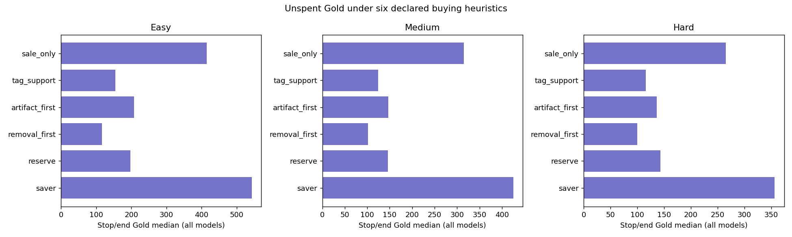
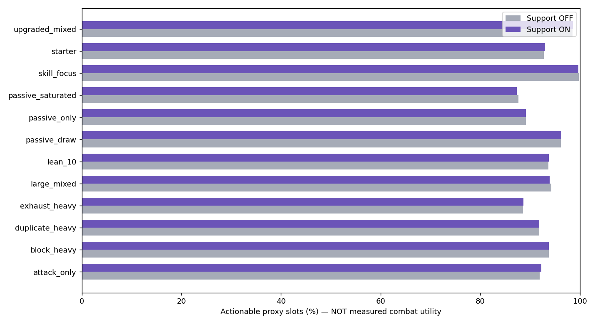
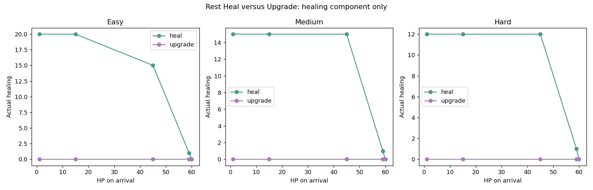
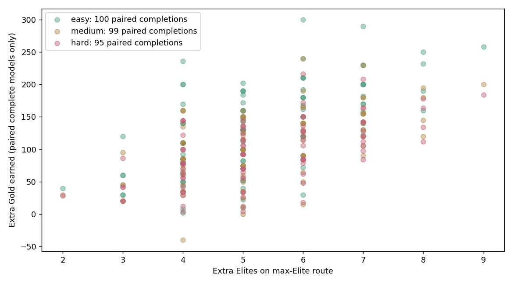

# Economy, Loot & Rewards — Deep Validation

Status: CADANGAN; CP UNMEASURED. Base 2800f9a; branch balance/economy. No production tuning changed by this extension.

Observed coverage: **1,800 adaptive flows**, 100 identical paired seeds per policy/difficulty; **600 controlled route flows**; **165,888 card offers / 525,312 slots**; **3,720 event timing/answer cases**, **5,400 HP/Gold boundary cases**, **240 Rest cases**.

## Meaning and limits

Every fight is pre-won after paying an explicit moderate (4/8/12) or severe (7/14/20) normal/Elite/Boss HP budget. No card/artifact strength reduces those budgets. MODEL_HP_BUDGET_EXHAUSTED means the assumed HP budget could not be paid; it is not observed combat defeat. All stop/end cash includes incomplete models. Completed-only cash is reported separately. These results cannot validate pupil win rates, optimal buying or combat power.

The same 100 seeds are replayed for all six policies and all difficulties. Answer profile cycles every four seeds; budget every four-seed block. Each of eight sensitivity cells has 12 or 13 unique seeds. This pairing controls seed/profile/budget when comparing policies; it does not provide 100 independent seeds per sensitivity cell. Four fixed answer profiles use 40/60/80/95% hash thresholds and fixed 55/35/15/15 second response times. Artifact wrong answers permit up to three wrong choices followed by a correct choice; retries add time but do not remove the gift. Mystery answers settle once and exact deadlines time out.

## Spending and recovery

| Difficulty | Policy | N | Completed models | Stop/end Gold p05 / median / p95 | Completed Gold median | Spent median |
|---|---|---:|---:|---|---:|---:|
| easy | sale_only | 100 | 96 | 320 / 415 / 528 | 413 | 63 |
| easy | tag_support | 100 | 96 | 41 / 155 / 424 | 153 | 344 |
| easy | artifact_first | 100 | 91 | 10 / 208 / 487 | 198 | 376 |
| easy | removal_first | 100 | 96 | 9 / 117 / 406 | 115 | 362 |
| easy | reserve | 100 | 96 | 59 / 197 / 477 | 195 | 286 |
| easy | saver | 100 | 92 | 445 / 543 / 633 | 545 | 0 |
| medium | sale_only | 100 | 81 | 218 / 315 / 420 | 310 | 70 |
| medium | tag_support | 100 | 81 | 25 / 124 / 350 | 115 | 270 |
| medium | artifact_first | 100 | 79 | 18 / 147 / 375 | 145 | 298 |
| medium | removal_first | 100 | 81 | 10 / 102 / 340 | 95 | 290 |
| medium | reserve | 100 | 81 | 42 / 146 / 376 | 136 | 253 |
| medium | saver | 100 | 75 | 320 / 425 / 515 | 440 | 0 |
| hard | sale_only | 100 | 70 | 184 / 265 / 349 | 267 | 77 |
| hard | tag_support | 100 | 69 | 39 / 116 / 300 | 116 | 226 |
| hard | artifact_first | 100 | 72 | 18 / 136 / 361 | 137 | 254 |
| hard | removal_first | 100 | 69 | 12 / 100 / 300 | 90 | 249 |
| hard | reserve | 100 | 70 | 43 / 143 / 344 | 137 | 201 |
| hard | saver | 100 | 67 | 257 / 356 / 455 | 380 | 0 |

Six heuristics: buy the single sale; support/category proxy with 20 Gold reserve; prioritize an economic/artifact tier heuristic; removal first; stage reserve 80/35; and save everything. Scores used to order decisions are arbitrary policy rules, not CP. Removal and purchases use actual engine quotes; no future loot is inspected. Full raw summaries retain affordability, purchases, recovery, answer attempts and last-Shop cash. Representative traces retain pending fight modifiers and conditional reward vectors.

## Deck offers

Across 3,438 Shop visits, 73 had no affordable card and 96 had no affordable actionable proxy on arrival. This can follow earlier spending and is not proof of bad pricing. Saver median stop/end Gold is 543 / 427.5 / 356 on Easy / Medium / Hard; the real effect of each purchase needs Combat input.

Twelve fixtures cover lean/large/duplicate/upgraded decks and Attack, Block, Skill/Focus, Passive/draw and Exhaust builds. Six sources preserve category restrictions before support weighting. Support ON/OFF first-slot rarity draws match; source/uniqueness, positive weights, unchanged player state, frozen receipts and question/combat RNG checks all run.

Invariant counters: `{"changedPlayerDecks": 0, "duplicateViolations": 0, "firstRarityPairMismatches": 0, "nonPositiveWeights": 0, "receiptReplayViolations": 0, "rngViolations": 0, "sourceViolations": 0}`.

Aggregated actionable-proxy change from support weighting ranges from -0.297 to +0.338 percentage points across fixtures. This is a small mixed effect, not evidence that weighting improves every deck. Requirement-ready and conditional-support counters must be inspected separately; retain bounded weights pending measured Combat utility.

Actionable proxy = requirement tags available, no already-owned Passive, fewer than two owned copies. It does not measure usefulness, activation likelihood, passive-slot contention or value of an upgraded replacement. See separate upgradeOpportunity counters in offers.json. Offers are independent cross-sectional fixtures; evolving decks are exercised by actual main flows. Waiting-time-to-specific-synergy is not estimated.

## Events and Rest

Cumulative stress adds 24 runs with HP sacrifice followed by Max HP sacrifice across two stages, reload after each settlement and repeat rejection. Forged extra cumulative Max HP sacrifice saves are rejected by the once-per-run cap. Eighteen adaptive-policy traces and six controlled-route traces retain actual reward vectors. scriptedAttemptTimeMs is attempted response time (including attempts after deadline), not actual elapsed play time.

all_event_timing.csv records every event and difficulty for correct/wrong, 35/55/75 seconds, one millisecond before deadline, exact deadline, abandon, skip before start and reward decline. events.json retains option-specific deltas, deadlines, modifiers, low-HP/Gold affordability and capped healing. Rest Heal is valuable only for missing HP; Upgrade has no healing component and its combat value requires Combat input.

**Explore: NEEDS_INPUT_DEFINITION.** No Explore action exists at this base; no invented reward is assigned.

## Route risk and reward

Exact dynamic-programming survey covers **200 maps / 5,500 legal paths counted**. Minimum/maximum Elite routes are exact; flows sample those two extremes and adaptive routes, rather than simulating all paths. **46/200 stage maps force at least one Elite**. Topology remains Map-owned. route_risk_pairs.csv includes stopped and complete runs; the graph compares only paired completions and therefore has explicit survivorship limits.

## Decisions and Master handoff

- Retain prices/rarity/support profiles: no measured CP or student data justifies numerical calibration.
- Use cash at last Shop and income after it before changing Gold rates: end cash can reflect late income or an intentional saver.
- Recheck low-affordability/proxy-rejected seeds from worst_seeds.csv with Combat value estimates; a rejected proxy is not proof an offer is useless.
- Combat input NEEDS_INPUT: damage distributions by build/accuracy, upgrade/removal/artifact marginal value, passive activation/cap, measured ICP/CCP.
- Map input NEEDS_INPUT: approved route coverage and mandatory-Elite decisions. Route economy is conditional on current topology.
- Three difficulty targets 90%/70%/50% remain unverified; model completion is not a pupil win rate.

## Reproduce

`node tools/economy/deep-study.cjs offers` / `events` / `flow` / `routes` / `traces` / `manifest`, then `python3 tools/economy/deep-report.py`. manifest.json records seeds, profiles, assumptions and source hashes. Raw JSON/JSONL evidence is also stored as deterministic .gz files in git; the report reader accepts either representation. All original v1.2 evidence remains intact.
