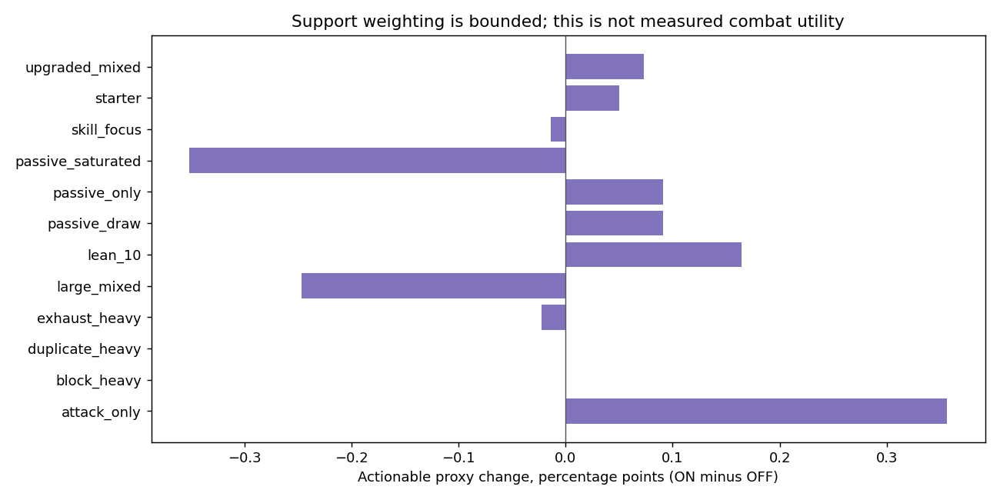
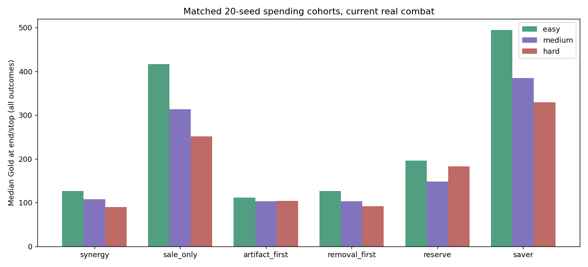

# Economy, loot & rewards — compatibility recheck

24 October 2026. Compatibility status **VALID for the recorded economy measurement/transaction scope**. Overall balance calibration remains **BELUM DISAHKAN**; decisions and limits follow.

Main inspected: `50d3af423cdc2240e949f4ddf29e023865304b65` (game2.36.0). Previous Economy: `df53579593937c2d71fcb6bb96409036ad575070`; it is already merged into that main. Current binding: `master-1.4.0-candidate.4`, definition `49a62f950a6208243e2f4afa237d9b19bb6995247688d869f3c28dc6c1b3f194`. Publication branch: balance/economy only.

## What changed

| Finding | Status | Evidence and resolution |
|---|---|---|
| Artifact affordability ignored Easy/Hard Shop multiplier | VALID (fixed) | tools/balance/map-advanced/telemetry.cjs now uses E.shopPrice, the actual checkout quote. Regression tests cover just below/at the affordability boundary. |
| Purse credits were netted against purchase spending | VALID (fixed) | Track newly acquired Gold credits separately, then gross spending, including Shop and room totals. Medium Purse +40 is counted as earned and the full quote as spent. Net Gold and engine actions are unchanged. |
| Old economy evidence described 60 HP, 5/15% discounts, +25 Purse and guaranteed eventual artifact answers | VALID (historical context clarified) | New tables use actual Master70/65/60 HP, 10/20% discounts, +40 Purse, Easy18 HP Rest and two-attempt gift loss. Older cohorts remain pinned to their original rules. |
| Seven ordinary prices changed with new Energy costs | BELUM DISAHKAN | Ordinary keeps Energy-band prices; Master keeps rarity prices. Burning Page 1→0 Energy gives 45→60 ordinary Gold under the existing zero-cost band. No automatic price retuning from unmeasured CP. |
| 12 Easy/Predict-skip campaigns reach the 100-turn Boss1 cap | BELUM DISAHKAN | Censored states are valid and kept separate from defeats/invalid cases; exact seeds, trace hashes and matched state/deck replays are supplied. No limit was increased to manufacture completion. |

## Current numbers and frozen offers

Read current-profiles.csv, current-master-price-quotes.csv, ordinary-price-changes.csv and all-event-values.csv. Prices remain 50/75/110 by Master rarity; artifacts80/140/220; removal50+15n; sale60%; only highest artifact discount. First paid removal is checked per profile and the runtime remains the owner of its quote. Shop remains six unique cards and one sale; 3 Starting/2 Elite-Mystery/1 Boss, with Boss locked until Stage2.

Fresh source study: **165,888 offers / 525,312 slots**, 128 recorded seeds, 12 fixtures, three contexts, six sources, three difficulties and paired support ON/OFF. **165,888 frozen receipt replays** and **82,944 first-slot rarity comparisons** pass; no player deck mutation or combat/question stream change. Source/category restrictions are applied first, including Skill-only ME03 and same-category transforms. CP remains null/UNMEASURED.

An actionable proxy only means requirement tags ready, no already-owned Passive and fewer than two owned copies. It does not measure utility, passive-slot contention or upgrade value. Current rarity/weight inputs are exported in tables.json.gz; historical card CP rankings must not be treated as measurements of candidate.4.

## Events, recovery and transactions

**3,360 event cases**, **1,080 HP/Gold boundary cases**, **96 Rest cases** and **600 Shop fixtures** use current Master definitions. Every event/difficulty includes first-correct, wrong→correct, two wrong, 55-second answer, exact-deadline timeout, wrong→deadline timeout, abandon, skip and decline. Correct retry preserves the initial deadline. Failed artifact trials continue without the gift; failed Boss trials still perform profile recovery and preserve the Stage2 checkpoint. Fixed1000-Gold Shop transactions are stress fixtures only; their affordability is recorded before injecting that budget.

Actual browser: **24 checks**, desktop1440×900 and phone390×844, all difficulties, no page errors. Covered six slots/sale, checkout/refresh, Stage1 Boss lock, Purse charge/+40, Rest and valid saved state. No external account or live delivery service was tested.

## Real engine campaigns

**600 primary attempts: 341 victories, 247 defeats, 12 bounded/censored, zero invalid**. Real damage/Block/Focus/artifact effects, connected routes, carried HP/deck, actual questions, purchases and rewards are resolved. No enemy HP, seal, victory or HP-cost fixtures are injected. **2,102 paid transactions** pass exact quote/grant conservation, frozen stock, unchanged combat/question RNG and save restoration. Across **1,344 Shop visits**, **31** have no affordable card on arrival.

Sampling: 100 identical seeds/difficulty for the current synergy policy; first20 matched seeds/difficulty for each of five spending sensitivities. This is300 baseline plus300 sensitivity attempts. Compare policies using matched20 rows; all100 baseline rows retain broader seed coverage. Per-seed Predict profiles cycle feedback/high/low/skip; route cycles health-recovery/seek-shop in blocks of four. Eight Predict/route strata have12/13 seeds in the100-seed baseline and2/3 in matched20. No expert multi-turn agent is evaluated: all runs use the official intermediate agent and the same mechanic-aware acquisition owner except the named spending override.

Predict high/low use declared synthetic canonical-key probabilities85%/25% and stop after a first wrong answer; feedback guesses untried choices within the real two-attempt limit; skip never opens Predict. Artifact/Mystery choices retain feedback guesses with two attempts, independently of the Predict label. Responses are one second per attempt in campaigns; the separate event matrix covers slow answers and deadlines. These are declared policy experiments, not pupil ability measurements.

| Difficulty | Policy | N matched | Win / loss / censored | End/stop Gold p05 / median / p95 | Victory-only Gold median |
|---|---|---:|---|---|---:|
| easy | synergy | 20 | 15 / 4 / 1 | 35 / 126.5 / 235 | 108 |
| easy | sale_only | 20 | 15 / 4 / 1 | 195 / 416.5 / 520 | 445 |
| easy | artifact_first | 20 | 15 / 4 / 1 | 9 / 111.5 / 231 | 92 |
| easy | removal_first | 20 | 15 / 4 / 1 | 35 / 126.5 / 235 | 118 |
| easy | reserve | 20 | 15 / 4 / 1 | 48 / 195.5 / 348 | 183 |
| easy | saver | 20 | 15 / 3 / 2 | 240 / 495.0 / 541 | 495 |
| medium | synergy | 20 | 13 / 7 / 0 | 25 / 107.5 / 201 | 79 |
| medium | sale_only | 20 | 12 / 8 / 0 | 145 / 313.5 / 400 | 327.5 |
| medium | artifact_first | 20 | 14 / 6 / 0 | 15 / 102.5 / 195 | 90.0 |
| medium | removal_first | 20 | 12 / 8 / 0 | 15 / 102.5 / 215 | 87.5 |
| medium | reserve | 20 | 13 / 7 / 0 | 55 / 148.5 / 285 | 135 |
| medium | saver | 20 | 12 / 8 / 0 | 195 / 385.0 / 445 | 407.5 |
| hard | synergy | 20 | 8 / 12 / 0 | 23 / 90.0 / 169 | 96.0 |
| hard | sale_only | 20 | 5 / 15 / 0 | 117 / 251.5 / 342 | 268 |
| hard | artifact_first | 20 | 8 / 12 / 0 | 33 / 104.0 / 186 | 109.5 |
| hard | removal_first | 20 | 7 / 13 / 0 | 23 / 91.5 / 347 | 91 |
| hard | reserve | 20 | 9 / 11 / 0 | 37 / 182.5 / 267 | 127 |
| hard | saver | 20 | 7 / 13 / 0 | 172 / 329.0 / 394 | 380 |

All-outcome cash includes early deaths and capped runs. Victory-only cash has survivorship selection and is explicitly separate. Raw records retain rooms, resources, upgrades, artifacts, paid transactions and selected detailed action traces. Gold at death is not proof of excessive income or lack of useful items; route timing and marginal combat value remain relevant.

## Master handoff and limits

1. Take the telemetry correction before comparing current spending/affordability; historical raw cohorts retain their original telemetry and must not be relabeled.
2. Review ordinary price bands for the seven changed-cost cards, especially Burning Page. Master prices and its override config were not retuned.
3. Inspect all12 bounded cases using censored-seeds.csv and censor-replays.json.gz. They are all Easy/Boss1/Predict-skip; determine whether they are slow policy behavior or unacceptable stalemates with Combat. No claim is made about their eventual outcome.
4. Reassess current card/Focus/setup/upgrade marginal value before changing rarity or support weighting. Earlier Master power tables describe older bindings.
5. Explore still has no runtime owner; Heal/Upgrade are the implemented Rest choices. Adding Explore needs an explicit mechanic contract.
6. Pupil90%/70%/50% win targets remain UNMEASURED. Paired policies/routes are not independent pupil observations; caps and deaths remain in the denominator.

## Reproduce and evidence

Run node tools/economy/recheck.cjs offers; node tools/economy/recheck.cjs events; node tools/economy/recheck-tables.cjs; node tools/economy/recheck-campaigns.cjs; node tools/economy/recheck-censored.cjs; node tools/economy/recheck.cjs manifest; then python3 tools/economy/recheck-report.py. Existing campaign rows are resumed only after engine-provenance checks; delete/move the output deliberately for a full fresh replay. Manifest has exact seeds and source hashes. Full unit/browser/build results are in VERIFICATION.md.

Development-pilot data are quarantined in development-pilot.jsonl.gz and excluded from every600-case total. The initial harness mistook the benchmark cap for an invalid campaign; a failing regression now preserves censored outcomes. Runner summary classification was corrected after measurement, retaining all original primary outcome records and performing no game action or limit change.

## Closing main compatibility

Main advanced during the work from2.36.0 / 50d3af4 to2.37.0 / 6376a222169815af582cf55aa4794f3c809a3515. Master SOR1.2.0 and the documentation audit were read. All changed main files were inspected; financial, Combat and acquisition owners are byte-identical between the two snapshots. The isolated audit checkout was advanced to2.37.0 preserving the new icon/UI changes and both documentation histories. The600 campaigns/928-test cohort retains its2.36.0 source; current UI/scope tests, browser and production build are rechecked separately on2.37.0. See main-compatibility.json and VERIFICATION.md. The original campaign module snapshot is retained; only event-fixture attempt-count reporting was clarified afterwards, with identical campaign/spendingPolicy function hashes.
