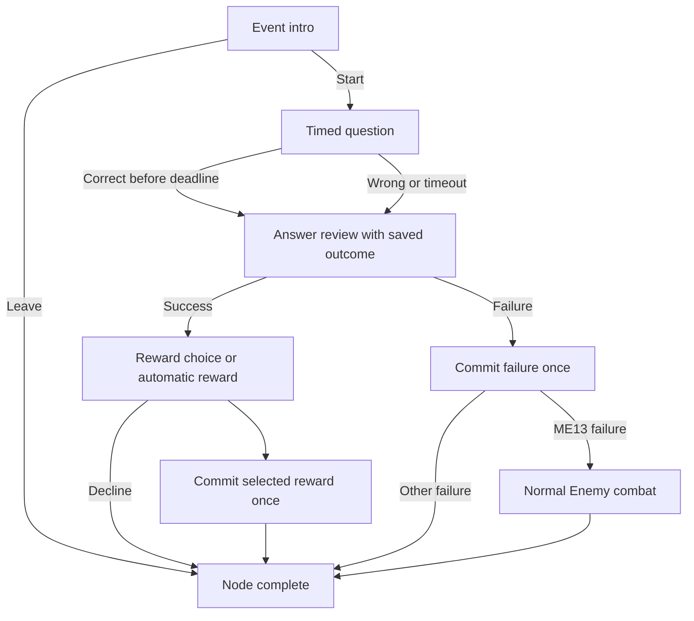

# SOR MYSTERY EVENTS — SLAY THE MATH

**Versi 2.0.0 · 22 Oktober 2026**

## 1. Skop

15 scene individu PNG 7680×4320, empat preview 2×2, jadual mekanik lengkap tujuh lajur, konfigurasi JSON, dan spesifikasi integrasi node `?`. Scene 1 menggunakan versi terakhir yang telah dibetulkan: Alyssa di kiri, proporsi dewasa tinggi dan sudut luas. Scene 2–15 dijana semula sebagai gambar penuh berpandukan komposisi itu, bukan crop daripada panel sheet lama.

Semua PNG 8K ialah export upscale daripada sumber yang lebih kecil. Saiz piksel akhir ialah 7680×4320; ia bukan dakwaan detail asal native 8K. Manifest menyatakan dimensi sumber, hash dan cara export. `MODEL.zip` dalam permintaan ini gagal dimuat naik dan tidak digunakan; rujukan yang dipakai ialah scene dan model empat POV yang telah tersedia daripada perbualan terdahulu.

Pakej ini ialah bahan integrasi, bukan patch source game. Angka ganjaran, penalty dan timer mengikuti jadual pengguna dan masih memerlukan playtest dalam game sebenar.

## 2. Fail utama

| Fail/folder | Tujuan |
|---|---|
| `scenes_8k/` | Tepat 15 scene bersaiz 7680×4320, background penuh, tanpa teks atau bingkai sheet. |
| `preview_sheets/` | Empat sheet 2×2 untuk semakan. Petak terakhir ialah tajuk penutup, bukan event 16. |
| `docs/JADUAL_MEKANIK_MYSTERY_EVENTS_v2.md` | Jadual tujuh lajur seperti permintaan pengguna. |
| `data/mystery-events.v2.json` | ID, topik, timer tetap, syarat, reward, penalty dan effect types. |
| `data/asset-manifest.v2.json` | Padanan assetKey/ME01–ME15, PNG, resolusi dan SHA-256. |
| `data/question-bank-form4-120.json` | Snapshot bank 120 asal, disalin tanpa mengubah jawapan. |
| `VERIFICATION.json` | Hasil pemeriksaan pakej. |
| `PARTS_INDEX.md` | Senarai bahagian ZIP dan cara menggabungkan folder hasil extract. |

Jadual mekanik berikut ialah rujukan kandungan. Untuk mesin, gunakan `timeLimitSeconds`, `success.options`, `costs`, `requires`, `effects` dan `failure.effects` dalam JSON.

## 3. Jadual mekanik lengkap

| # | Mystery Event | Topik dan cabaran pendidikan | Had masa | Cadangan artwork | ✅ Jawab betul dalam masa | ❌ Jawapan salah / masa tamat |
|---|---|---|---|---|---|---|
| **1** | **The Suspicious Chest** | **P:** Kira peluang memperoleh harta daripada kandungan peti yang ditunjukkan. | **30 saat** | Alyssa memeriksa peti dengan mekanisme perangkap. | Peti terbuka dengan selamat. Dapat 40 Gold. | Perangkap aktif. Hilang 4 HP, tanpa ganjaran. |
| **2** | **The Ember Shrine** | **L:** Pilih penafian yang betul bagi pernyataan pada altar. | **30 saat** | Altar api dengan dua ukiran rune bertentangan. | Boleh korbankan 5 HP untuk upgrade satu kad. | Api menyambar. Hilang 2 HP dan peluang upgrade tamat. |
| **3** | **The Whispering Grimoire** | **S:** Tentukan kesatuan dua set simbol pada halaman buku. | **45 saat** | Grimoire terbuka dengan simbol terapung. | Pilih satu daripada tiga Skill cards, secara percuma. | Buku tertutup. Tiada kad diperoleh. |
| **4** | **The Cracked Mirror** | **L:** Kenal pasti implikasi yang sepadan dengan petunjuk cermin. | **45 saat** | Pantulan Alyssa memegang kad berbeza. | Boleh transform satu kad menjadi kad rawak daripada kategori sama. | Cermin pecah. Peluang transform hilang. |
| **5** | **The Forgotten Fountain** | **S:** Cari persilangan dua set rune untuk mengaktifkan pancuran. | **30 saat** | Pancuran batu bercahaya dengan syiling di dasar. | Pilih pulihkan 15 HP atau dapatkan 25 Gold. | Pancuran menjadi kering. Tiada ganjaran. |
| **6** | **The Bound Collector** | **P:** Kira peluang mendapat artifact tertentu daripada kumpulan cabutan. | **45 saat** | Pengumpul berantai dengan rak artifact. | Boleh tukar satu Starting artifact + 30 Gold untuk satu Elite/Mystery artifact rawak. | Pengumpul menutup tawaran. Pertukaran dibatalkan, tanpa bayaran. |
| **7** | **The Lost Scholar** | **L:** Tentukan sama ada kesimpulan mengikuti premis yang diberikan. | **60 saat** | Sarjana misteri menunjukkan helaian soalan kepada Alyssa. | Dapat 30 Gold dan upgrade satu kad. | Tiada ganjaran; sarjana menerangkan penyelesaian. |
| **8** | **The Blind Oracle** | **P:** Kenal pasti peristiwa saling eksklusif daripada ramalan yang diberikan. | **30 saat** | Peramal bertutup mata dengan dua rune ramalan. | Pilih +2 Strength atau +2 Agility untuk pertarungan seterusnya. | Ramalan menjadi kabur. Tiada buff diperoleh. |
| **9** | **The Broken Forge** | **S:** Cari beza dua set untuk memilih bahan penempaan yang betul. | **45 saat** | Relau berbara dengan bahan bertanda rune. | Boleh bayar 35 Gold untuk upgrade satu Attack atau Defend card. | Relau padam. Peluang upgrade hilang, tanpa bayaran. |
| **10** | **The Burning Archive** | **S:** Tentukan pelengkap suatu set untuk mengenal pasti manuskrip yang perlu diselamatkan. | **45 saat** | Alyssa memilih manuskrip dalam perpustakaan terbakar. | Pilih buang satu kad daripada deck atau dapatkan 25 Gold. | Terkena bara. Hilang 3 HP, tanpa ganjaran. |
| **11** | **The Cinder Garden** | **P:** Kira peluang memperoleh buah dengan sifat A atau B, termasuk pertindihan. | **45 saat** | Taman dungeon dengan buah dan tumbuhan bersimbol. | Pilih pulihkan 10 HP atau satu Starting artifact rawak. | Tumbuhan mengeluarkan duri. Hilang 3 HP, tanpa ganjaran. |
| **12** | **The Fallen Adventurer** | **S:** Gunakan maklumat rajah Venn untuk menentukan bilangan bekalan. | **60 saat** | Beg, kad dan pedang patah milik pengembara lama. | Pilih 40 Gold atau satu daripada tiga kad yang ditawarkan. | Bekalan menjadi debu. Tiada ganjaran. |
| **13** | **The Echo Chamber** | **L:** Nilai pernyataan menggunakan “dan” atau “atau” untuk mengenal pasti gema palsu. | **45 saat** | Alyssa dikelilingi bayangan musuh daripada debu. | Gema dimusnahkan tanpa bertarung. Dapat 40 Gold. | Gema menjadi nyata. Pertarungan Normal Enemy bermula. |
| **14** | **The Shattered Hourglass** | **P:** Lengkapkan pengiraan kebarangkalian peristiwa bergabung berdasarkan petunjuk jam pasir. | **60 saat** | Jam pasir pecah dengan pasir dan kad membeku di udara. | Draw dua kad tambahan pada giliran pertama pertarungan seterusnya. | Kurang 1 Energy pada giliran pertama pertarungan seterusnya. |
| **15** | **The Dungeon Master's Bargain** | **L:** Gunakan beberapa premis untuk memilih kesimpulan yang sah tentang perjanjian. | **60 saat** | Dungeon Master menghulurkan artifact dan rune pengorbanan. | Boleh korbankan 5 Max HP untuk satu Elite/Mystery artifact rawak. | Tawaran ditarik balik. Tiada artifact dan tiada pengorbanan Max HP. |

## Aturan bersama

- Semua tawaran berbayar ialah pilihan selepas berjaya. Kos hanya dikenakan selepas confirmation, bersama ganjaran dalam satu transaksi.
- “Atau” bermaksud pilih satu; “dan” pada The Lost Scholar bermaksud kedua-dua kesan dalam satu bundle.
- Kesan Strength/Agility tamat selepas pertarungan seterusnya. Draw/Energy event 14 hanya pada giliran pertama pertarungan seterusnya.
- Artifact reward menggunakan tier Starting atau Elite/Mystery, tanpa Boss artifact dan tanpa salinan artifact yang sedang dimiliki.
- Dasar penalty HP v1 diteruskan: damage gagal dihadkan supaya HP minimum 1. Paparkan jumlah sebenar sebelum mula; bayaran sukarela 5 HP mesti dibayar penuh sambil meninggalkan sekurang-kurangnya 1 HP.
- Salah atau timeout memaparkan jawapan betul dan penerangan. Cubaan pembelajaran selepas itu tidak mengulangi reward.
- Angka/sifat rune untuk pengiraan mesti dipaparkan dalam prompt soalan. Jangan menggunakan jumlah syiling atau simbol dekoratif yang dijana dalam artwork sebagai data matematik.
- Nilai ini ialah spesifikasi gameplay untuk implementasi dan playtest; fail ini tidak memasang perubahan ke dalam game secara automatik.

## 4. Standard artwork

- Alyssa di kiri dan menghadap kanan, proporsi kepala/torso/kaki mengikut model dewasa yang telah disahkan. Seluruh badan dan kedua-dua boots kelihatan, berpijak pada lantai.
- Sudut kamera luas. Ada ruang atas, bawah, kiri dan kanan bagi watak serta objek utama; kanan lebih tenang untuk UI soalan atau keputusan.
- Reka bentuk rambut merah panjang, armor hitam/burgundy bertrim emas, grimoire, pedang api dan aksesori kekal konsisten. Magic Alyssa ialah api sahaja.
- NPC Collector, Scholar dan Oracle mempunyai siluet berbeza. Dungeon Master mempunyai muka, mata dan dua tangan jelas, serta tubuh yang menyatu dengan dungeon; bukan portal atau ahli sihir manusia.
- Soalan dan UI dirender berasingan. Dekorasi rune atau bilangan barang dalam artwork tidak menjadi data pengiraan secara automatik.

## 5. Aliran node

1. Pemain menekan node `?`. Pilih event belum dilihat dalam run yang layak dan mempunyai soalan belum digunakan dalam topik ditetapkan.
2. Paparkan scene, intro ringkas, topik, masa tetap, success, risiko failure, `Start Challenge` dan `Leave`.
3. Pada intro pertama, tandakan event sebagai digunakan. Belum ada soalan atau resource dianggap digunakan jika pemain memilih Leave sebelum mula.
4. Soalan dan empat pilihan sedia/interaktif → simpan pending question ID, susunan choice ID, waktu mula dan deadline; rekod exposure soalan; kemudian mula countdown.
5. Satu jawapan sahaja. Betul sebelum deadline → success. Salah pertama, timeout atau meninggalkan selepas mula → failure.
6. Tunjukkan jawapan betul dan penerangan ringkas. Jika berjaya, jalankan pemilihan reward/target atau confirmation tawaran. Reward automatik tidak memerlukan popup pilihan palsu.
7. Commit kos dan kesan sekali sahaja, kemudian kembali ke map. Bagi failure ME13, selepas review dan Continue, mulakan satu Normal Enemy combat yang telah disimpan ID/seednya.

## 6. Topik, soalan dan RNG

| Kod jadual | topicCode | topicId bank snapshot | Bab Tingkatan 4 |
|---|---|---|---|
| P | PROB | T1 | 9 — Kebarangkalian Peristiwa Bergabung |
| S | SET | T2 | 4 — Operasi Set |
| L | LOGIC | T3 | 3 — Penaakulan Logik |

Lima event setiap topik. Gunakan preferredQuestionIds yang sesuai dengan objektif dahulu; jika habis, fallback kepada soalan belum digunakan daripada topik sama sahaja dan gunakan arahan neutral “Solve this challenge”. Jangan menukar angka/jawapan untuk memaksa padanan gambar. Jangan tukar ke topik lain secara senyap.

Soalan diambil tanpa penggantian melalui stable question ID. Satu `usedQuestionIds` dikongsi dengan pemilihan artifact. Exposure direkod apabila soalan pertama kali dipaparkan, termasuk jawapan salah, timeout atau abandoned. Susunan A–D/seed baru bukan soalan baru.

Kontrak bank snapshot menyimpan history soalan merentas run baharu sehingga reset bank dipilih secara jelas. Event history pula boleh reset pada run baharu. Pisahkan event RNG, question RNG dan reward RNG; simpan state/counter supaya reload tidak reroll.

Jika pool topik habis, event tidak layak. Jika semua pool habis, `No unused challenges available. Continue.` tanpa kos, reward atau penalty. Jangan recycle soalan secara senyap.

Snapshot ini `form4-review-1.0.0`, berstatus draft untuk semakan. Jika game sudah menggunakan QUESTION BANK / STM shared yang lebih baharu, gunakan service dan history semasa melalui adapter; jangan overwrite bank aktif, rich text atau exposure history dengan snapshot lama. Sahkan pemetaan ID/topik/choice schema terhadap bank aktif. Snapshot diberi untuk rujukan kompatibiliti, bukan sebagai pengganti automatik versi terkini.

## 7. Had masa tetap

Timer tepat mengikut event: 30, 45 atau 60 saat seperti jadual. V2 tidak menggunakan formula lama `max(timer, difficulty minimum)`. `baseTimeSeconds` dikekalkan sebagai alias dengan nilai sama, tetapi sumber utama ialah `timeLimitSeconds`.

Mula countdown selepas semua pilihan interaktif, bukan semasa artwork/font masih loading. Tab hilang fokus tidak pause. Simpan deadline mutlak, dan gunakan jam monotonic untuk countdown semasa sesi. Reload menyambung soalan, pilihan dan deadline sama. Jika sudah luput ketika resume, resolve TIMEOUT sekali.

Jawapan mesti diterima pada timestamp yang kurang daripada deadline. Pada/selepas deadline ialah timeout walaupun jawapan betul. Submit dan callback timer berkongsi settlement lock; jawapan tidak boleh resolve kedua-dua success dan failure. Loading error bukan jawapan salah; resume pending item tanpa penalty teknikal.

Kesukaran soalan boleh dipaparkan sebelum mula. Sebarang penalaan masa atau tapisan difficulty perlu diubah secara sengaja dalam spesifikasi/game; jangan memanjangkan masa secara tersembunyi. Timer ini tidak mengubah semua mekanik soalan lain.

## 8. Kos dan transaksi

Setiap item `success.options` ialah pilihan alternatif. Semua `effects` dalam satu option ialah bundle yang berlaku bersama. ME07 ialah Gold DAN upgrade; ME05/10/11/12 ialah satu pilihan ATAU yang lain.

Kos hanya dikenakan selepas jawapan betul dan confirmation. Semak eligibility dan baki sekali lagi ketika commit. Kos serta reward atomik: rollback jika satu bahagian gagal. Gunakan key `runId:nodeId:eventId`; double click, Continue berulang atau reload tidak boleh memberi reward dua kali.

| Kes | Aturan pelaksanaan |
|---|---|
| ME02 | Perlu HP sekurang-kurangnya 6 dan ada kad belum cap upgrade. Bayar penuh 5 HP, tinggal sekurang-kurangnya 1. |
| ME03 | Tawarkan tiga Skill card IDs unik jika tersedia; jika calon kurang, paparkan bilangan sebenar. Tambah satu kad sahaja. |
| ME04 | Ganti satu card instance pilihan pemain dengan ID lain kategori sama, level upgrade 0. Persist calon random; batal/reopen tidak reroll. |
| ME06 | Ada Starting artifact, ≥30 Gold dan calon Elite/Mystery belum dimiliki. Pilih artifact yang dilepaskan, remove/recalculate stats dan grant baru dalam satu transaksi. |
| ME07 | Pilih satu upgrade target sebelum commit; jangan beri 30 Gold separa jika pilihan dibatalkan. |
| ME09 | Hanya Attack atau Defend yang boleh upgrade; ≥35 Gold. |
| ME10 | Remove satu instance sahaja; patuhi protected cards dan minimum deck tidak kosong. Jika tiada target, pilihan Gold masih sah. |
| ME11 | Heal disabled jika HP penuh; artifact disabled jika pool Starting belum dimiliki kosong. |
| ME12 | Gold ATAU satu kad daripada offer yang dipersist; bukan kedua-duanya. |
| ME13 | Failure dijadualkan selepas review. Encounter Normal Enemy ikut stage semasa, ID/seed dipersist. Reward kemenangan ikut combat biasa tanpa bonus event tambahan. |
| ME15 | Perlu Max HP ≥6 dan calon artifact sah. Bayar 5 Max HP, `currentHp=min(currentHp,newMaxHp)`. Jangan tolak 5 current HP sekali lagi. |

Semua artifact reward mengecualikan Boss tier dan artifact yang sedang dimiliki. Jika pool kosong, disable option atau event sebelum cabaran; jangan menggantikan dengan Boss tier. Jangan mengambil bayaran jika pilihan tidak lagi sah. Tiada kos untuk menolak tawaran selepas berjaya.

Damage gagal di luar combat mengabaikan Block/Defense. Dasar v1 minimum HP 1 diteruskan: actualDamage=min(requestedDamage,max(0,currentHp−1)). Paparkan angka sebenar sebelum mula. Ini tidak mengubah aturan mati semasa combat ME13 atau pertarungan biasa.

## 9. Modifier sementara

ME08 +2 Strength/Agility digunakan sepanjang pertarungan sebenar seterusnya dan tamat selepas combat itu. ME14 +2 Draw atau −1 Energy hanya pada giliran pertama pertarungan seterusnya. Clamp Energy minimum 0. Gunakan hook draw/energy serta aturan hand limit game sedia ada.

Normal, Elite, Boss dan forced combat ME13 semuanya dianggap pertarungan seterusnya. Tutorial/practice atau combat gagal load tidak consume modifier. Simpan modifier bersama combat ID dan marker applied supaya reload tidak menambahnya dua kali. Modifier additive menunggu boleh dijumlahkan; jangan mengubah stat kekal. Kesan menunggu boleh dibawa ke stage berikutnya dalam run sama, lalu dibuang apabila run berakhir.

## 10. Dispatcher effect dan syarat

Effect types: ADD_GOLD, HEAL_HP, DAMAGE_HP, UPGRADE_CARD, TRANSFORM_CARD, REMOVE_CARD, CHOOSE_CARD_REWARD, CONSUME_ARTIFACT, GRANT_ARTIFACT, QUEUE_COMBAT_MODIFIER, START_COMBAT. Gunakan dispatcher yang dikenali; jangan eval JSON sebagai JavaScript.

Condition types: HAS_UPGRADABLE_CARD, HAS_CARD_REWARD_CANDIDATE, HAS_TRANSFORMABLE_CARD, HAS_MISSING_HP, HAS_OWNED_ARTIFACT, HAS_UNOWNED_ARTIFACT, HAS_REMOVABLE_CARD. Satu option actionable hanya jika semua `requires`, semua costs dan calon effect sah. Empty requires tidak membenarkan mengabaikan kos.

Pemetaan `STARTING`, `ELITE_MYSTERY`, `Attack`, `Defend`, `Skill`, `Passive` perlu disambungkan kepada registry game sebenar melalui adapter. Jangan teka numeric index. Kemunculan istilah lain dalam contoh akademik snapshot bukan arahan mencipta kategori kad atau elemen kuasa Alyssa.

## 11. Save/resume minimum

Simpan versi config/bank, runId, nodeId, eventId, stage, usedEventIds run, usedQuestionIds profile, RNG states/counters, pending question ID, ordered choice IDs, startedAt/deadline, selected choice ID, outcome, reward offers, selected target instance, selected reward option, committed settlement keys, pending combat ID/seed, modifier queue dan applied combat IDs.

Semak jawapan melalui `correctChoiceId`, bukan label A–D. Simpan offers rawak sebelum paparan. Crash sebelum commit menyambung transaksi belum selesai dengan calon sama; selepas commit hanya resume review/transition. Leave sebelum Start tiada question exposure; Leave selepas Start dikira failure; technical load error bukan failure.

## 12. Rich text dan bahasa UI

UI game menggunakan English ringkas: Start Challenge, Leave, Correct, Time Up, Continue, Choose One. Dokumentasi dan jadual menggunakan BM. Kekalkan structured rich-text tokens daripada bank aktif dan tema STM shared yang sedia ada.

| Jenis token | Hover | Underline |
|---|---|---|
| Calculation | Ungu lembut | Dashed |
| Math terms | Merah jambu lembut | Dashed |
| Game terms | Hijau lembut | Dashed |

Rujuk theme renderer semasa; jangan hardcode warna berlainan atau menyuntik raw HTML. Tooltip tidak mengubah teks/angka jawapan dan tidak memberi reward tambahan. Hint/pembetulan selepas keputusan tidak membenarkan cubaan reward kedua.

## 13. Urutan integrasi dan acceptance

Load asset keys → hubungkan node ? → shared question service → intro/timer/review/reward → atomic effect dispatcher → map/combat → save/resume. Kekalkan unsur surprise pada map; identiti event khusus hanya dipaparkan selepas masuk node.

Sebelum release game, uji: semua 15 asset betul; 5 event/topik; timer tetap seperti jadual; betul/salah/timeout hanya settle sekali; jawapan pada deadline dianggap timeout; shared question history tidak mengulang artifact/Mystery; pool habis tidak recycle; HP payment penuh; artifact trade rollback; ME07 bundle atomik; ME15 Max HP tidak ditolak dua kali; ME13 hanya satu combat; modifier luput pada combat/turn betul; reload tidak reroll atau duplicate reward; penerangan muncul selepas semua keputusan.

## 14. Tekstur dan semakan pakej

PNG 8K ialah master. Untuk runtime, bina derivative mengikut viewport/peranti dan load scene semasa sahaja. Satu texture RGBA8 7680×4320 bersamaan kira-kira 126.6 MiB sebelum mipmap. Jangan preload 15 texture 8K serentak.

`VERIFICATION.json` merekodkan dimensi, jumlah scene/event, padanan ID, fixed timers, topik, question references dan hash. Ia tidak mendakwa game source telah diubah, gameplay telah seimbang, atau semua matematik snapshot sudah diluluskan pengguna.
