# 09 — Dungeon, map bercabang dan room

Versi: 2.0.0. Dua stage/satu boss setiap stage, dungeon dan map bercabang mengikuti arahan Ijamm. Bentuk graph/nilai room berikut ialah cadangan kerja.

## Dunia

| ID | Label English kerja | Nama asal | Arah seni |
| --- | --- | --- | --- |
| stage_1 | Sigil Keep | Kubu Lambang | Runtuhan, brass, lambang dan kristal |
| stage_2 | Draw Tower | Menara Cabutan | Menara dungeon, arkib, rantai dan orbit kad |

Boss: Twin Sigil Guardian dan Deck Sovereign; ID kandungan lama dikekalkan. Tiga topik boleh muncul pada kedua-dua stage; dua stage tidak memaksa satu topik setiap stage.

## Graph, bukan satu baris node

**WRL-01:** Map ialah directed acyclic graph. Pemain memilih next node daripada edge sah; tiada teleport, backtrack atau mengulang reward.

Contoh graph setiap stage:

```mermaid
flowchart TD
  S["Start"] --> A["Battle A"]
  S --> B["Battle B"]
  A --> E["Mystery"]
  A --> H["Shop"]
  B --> E
  B --> H
  E --> C["Battle C"]
  E --> L["Elite"]
  H --> C
  H --> L
  C --> R["Rest"]
  L --> R
  R --> X["Boss"]
```

Ini contoh konfigurasi, bukan salinan tepat map Slay the Spire. Satu laluan melawat lima room dimainkan per stage: Battle → Mystery/Shop → Battle/Elite → Rest → Boss. Start ialah node automatik. Dua stage memberi 10 room dilawati; node yang tidak dipilih kekal di map.

## Jenis room

| Type | Label | Kandungan | Muzik |
| --- | --- | --- | --- |
| battle | Battle | Musuh biasa stage | Stage masing-masing |
| elite | Elite | Varian lebih kuat dan reward lebih tinggi | Elite stage 1/2 berbeza |
| rest | Rest | Heal atau Upgrade sekali | Rest |
| shop | Shop | Tawaran kad dengan Gold | Shop |
| mystery | Mystery / ? | Satu event dengan pilihan jelas | Mystery |
| boss | Boss | Penjaga akhir stage | Boss cue dicadangkan |

**WRL-02:** Show node type dan next edges sebelum memilih. Hover boleh menambah detail, tetapi tap/keyboard memberi maklumat sama. Elite jelas risikonya.

**WRL-03:** Room selesai tepat sekali. Reward/choice mesti diselesaikan atau dilangkau sebelum graph bergerak.

**WRL-04:** Boss stage 1 unlock stage 2 selepas reward; boss stage 2 menuju ringkasan. Semua laluan sah mesti mencapai boss.

**WRL-05:** Map state menyimpan currentNodeId, chosen edges, visited/completed node IDs dan room state yang belum selesai. Refresh tidak menukar route atau event offer.

## Rest, Shop dan Mystery

Rest: pilih heal 10 HP atau upgrade satu instance; jika tiada manfaat, Continue. Shop: stok disimpan sekali, transaksi atomic dan Gold tidak negatif. Mystery: pilih satu pilihan yang kesannya diterangkan sebelum confirm; ia tidak memberi pilihan/reward semula selepas reload.

Nilai ekonomi dimiliki [12](12_PROGRESSION_ECONOMY_BALANCE.md); graph tidak mempunyai harga atau damage hardcoded.

## Background dan naratif

**WRL-06:** Background mempunyai ruang MC, musuh dan VFX; HUD/teks tidak dilindungi dekorasi. Bahan kulit/brass dan lampu amber MC serasi dengan dungeon.

**WRL-07:** Arah cahaya, horizon dan skala watak konsisten. Setiap room boleh menggunakan variasi background tanpa memerlukan biome baharu.

Naratif satu atau dua ayat English mudah. Room Mystery bukan lesen untuk soalan mengelirukan atau kos tersembunyi.

## Penerimaan

Graph tiada cycle/dead end; boss reachable; pilihan mematuhi edge; satu boss setiap stage; Rest/Shop/Mystery/Elite boleh dipaparkan dan disimpan; route dan ganjaran tidak diulang selepas refresh.

Rujuk [07](07_ENEMY_BOSS_DESIGN.md), [10](10_UI_UX_ACCESSIBILITY.md), [11](11_ANIMATION_VFX_AUDIO.md) dan [13](13_TECH_ARCHITECTURE_DATA.md).

## Source Edition 2.0 update

The user requested a rebuild against nine current menu references plus the supplied arena/MC/enemy/music packages. Runtime evidence, exact scope, source mappings, new Shop tuning, route-version compatibility and limits are maintained in [Source Edition](../SOURCE_EDITION.md), decisions 35–39, `DESIGN.md` and `UX-CONTRACT.md`. Earlier prototype examples in this document remain history where superseded. The implemented evaluator remains Probability; other planned math modes are not claimed active.

## Dungeon Edition 2.1 — current integration

For new runs, modules/map/SOR/01_MAP_RNG.md is the current topology owner: ten levels per stage, 3–5 initial paths, exact 1/2/3 Shop, 4/6/7 Elite, 2/3/4 Rest quotas; mandatory Mystery level 5, Rest level 9 and Boss level 10. This supersedes earlier five-level examples. Routes 1/2 and legacy saves retain their original graph.

## Map presentation 2.4.1 — current user instruction

- **WRL-08:** Show room category, level, state and links before entry. Conceal encounter names, portraits, statistics and detailed enemy descriptions from map text, tooltips and accessible labels. Reveal the actual room after Enter Room. This supersedes any earlier identity-bearing preview.
- **WRL-09:** Keep all six category legends at the left. A selected category/level and Enter Room share the same left rail; node selection is presentation only.
- **WRL-10:** Space ten-level rows approximately 248 CSS units apart in a 2700-unit atlas. `journey.css` scales the map-only unit from 1px to 2px. The internal atlas scrolls to show the stage; keep visible scrollbars and readable seals. Current level restores the selected gate. Preserve both scroll axes during selection.
- **WRL-11:** Presentation changes never regenerate an existing map or change room identities, links, quotas, save schema or reward timing. Five-level legacy paths remain five-level paths.

## Direct map entry 2.4.2 — supersedes WRL-09/10 interaction details

- **WRL-12:** Activating an enabled map icon immediately calls the existing engine entry for that exact node. Pointer click, Enter and Space enter directly; focus alone does not. Disabled rooms remain inert.
- **WRL-13:** Remove the complete Selected Path/Enter Room/Current level area. The left rail is the six-category legend only. Keep map panning, level spacing and category-only surprise from WRL-08/10/11. No current-level shortcut or alternate confirmation is required.
- **WRL-14:** After entry, focus the new scene and reset document scrolling. Preserve the existing legal-edge, source snapshot, autosave and once-only completion owners.

## Parchment map and integrated mechanics — 2.11.0

The 2.11.0 map presentation follows the supplied parchment dungeon reference. `journey.css` owns its viewport-aware layout, left legend and live top HUD. The generated paper architecture is decorative; existing graph snapshots, 2700/1450-unit extents, category-only labels, native legal room buttons and both-axis scroll restoration remain authoritative. Both stages and legacy paths use the same renderer.

## Map, modes, Boss and Shop — 2.12.0

Map presentation 2.12: the existing plate is subdued; future/open/travelled paths have distinct weight, dash/color and text key. Explicit Floor, room category and Enter Room badges improve navigation. Narrow Floor labels sit above seals. No graph/RNG, secrecy or direct-entry rule changes.

## Mystery Events — 2.13.0

New Mystery rooms use the fifteen-event v2 owner [MYSTERY_EVENTS.md](MYSTERY_EVENTS.md): intro, optional timed question, final review and one settlement on the same legal node. Echo failure can host one Normal battle there. Map still conceals the specific event until entry.
