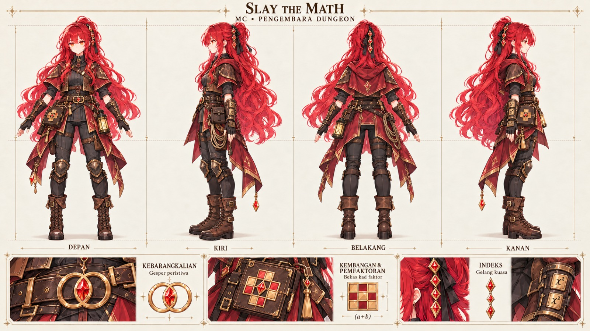
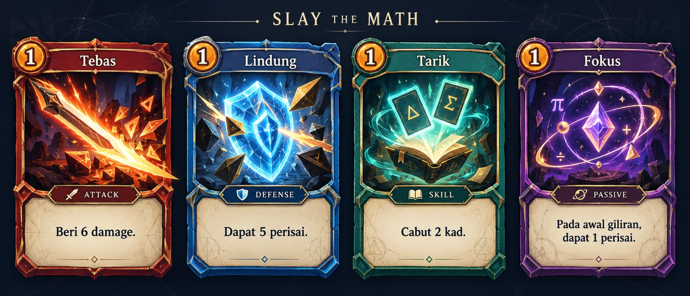
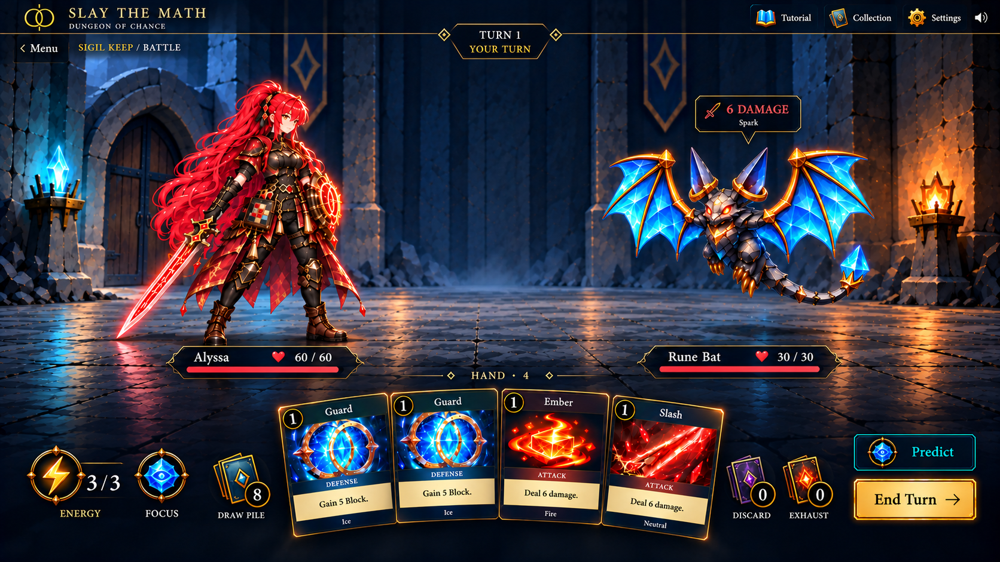

# 18 — Rujukan design awal dan impak SOR

Versi: 2.0.0 · 18 Oktober 2026 · Dua imej awal diberikan Ijamm.

## Kedudukan design

**REF-01:** Imej ialah rujukan kerja semasa yang boleh diperhalus. Ia tidak mengesahkan setiap trigger, angka, formula atau hak edaran.

**REF-02:** Arahan terkini dungeon, map bercabang, English mudah dan audio bilik turut diselaraskan. Runtime game dan byte imej asal tidak diubah.

## A — MC dungeon

Nama asal: WhatsApp Image 2026-10-18 at 13.12.10.jpeg. Saiz sebenar: 1600 × 900 px, JPEG.

Salinan pakej: references/mc_dungeon_concept_v001.jpeg. SHA-256: 26752e48dd2ccceff3aa67a5915ad0857c0be2d937c2635f5d62f02b9bdd91cc.

| Pemerhatian | Keputusan kerja | SOR |
| --- | --- | --- |
| Rambut merah, cape, kulit, armor ringan dan but | Dungeon adventurer menjadi kostum utama | [08](08_MC_CHARACTER_ART.md) |
| Lantern dan folio pada belt | Anchor sisi dan kesinambungan pose | [08](08_MC_CHARACTER_ART.md) |
| Gelang, grid, x²/x³ | Probability; Expansion & Factorisation; Indices | [02](02_MATH_LEARNING.md) |
| Empat pandangan sudah ada | Belakang kini mempunyai rujukan | [08](08_MC_CHARACTER_ART.md) |
| Label BM dan latar parchment | Label English dan eksport berasingan | [10](10_UI_UX_ACCESSIBILITY.md), [14](14_ASSET_PIPELINE.md) |

## B — Konsep kad

Nama asal: WhatsApp Image 2026-10-18 at 13.22.17.jpeg. Saiz sebenar: 1600 × 687 px, JPEG.

Salinan pakej: references/card_concepts_v001.jpeg. SHA-256: d48955a203b3fb8aeab4d94d9aefabdd1a383480fed27049da5aee40687bda4a.

| Pemerhatian | Keputusan kerja | SOR |
| --- | --- | --- |
| Nama atas, kos bulat kiri, artwork besar | Gantikan layout nama-di-bawah v1 | [05](05_CARD_VISUAL_DESIGN.md) |
| Frame merah, biru, teal dan ungu | Attack, Defense, Skill, konsep Passive | [05](05_CARD_VISUAL_DESIGN.md), [06](06_ICON_SYSTEM.md) |
| Panel parchment | Teks gelap, berasingan daripada artwork | [05](05_CARD_VISUAL_DESIGN.md) |
| Tebas/Lindung/Tarik | Slash/Guard/Draw melalui alias | [04](04_CARD_SYSTEM.md) |
| Fokus berlabel Passive | Konsep Ward; bukan resource Focus | [04](04_CARD_SYSTEM.md) |
| BM/English bercampur, π dekoratif | Produksi English; tiada topik tambahan automatik | [02](02_MATH_LEARNING.md), [10](10_UI_UX_ACCESSIBILITY.md) |

## Baseline yang digantikan

| V1 | Arah semasa |
| --- | --- |
| Mage merah/putih | Dungeon adventurer merah/arang/kulit |
| Tiga fokus Probability dianggap semua topik | T1/T2/T3; fokus lama menjadi subfokus T1 |
| Map linear lapan node | Map bercabang dan room types |
| Game default BM | English mudah dengan istilah RPG |
| Skill/Taktik ungu | Skill teal, konsep Passive ungu |
| Nama kad di bawah art | Nama atas, kategori bawah art, kesan pada parchment |
| Shop/gold selepas MVP | Shop dalam skop semasa; angka ekonomi masih cadangan |

## Batas

**REF-03:** Passive memerlukan kontrak kos, trigger, tempoh, stacking, luput dan save sebelum diaktifkan.

**REF-04:** T2/T3 ialah domain kandungan dalam design; gambar tidak memuktamadkan cara algebra/indices mengubah combat. Bank soalan dan kesan dibina melalui tugasan tersendiri.

**REF-05:** Kemas kini ini tidak menghasilkan battle sprite, kad berasingan, vektor, muzik atau animasi baharu.

Lihat [keputusan](DECISIONS.md) dan [changelog](CHANGELOG.md).

## Source Edition 2.0 update

The user requested a rebuild against nine current menu references plus the supplied arena/MC/enemy/music packages. Runtime evidence, exact scope, source mappings, new Shop tuning, route-version compatibility and limits are maintained in [Source Edition](../SOURCE_EDITION.md), decisions 35–39, `DESIGN.md` and `UX-CONTRACT.md`. Earlier prototype examples in this document remain history where superseded. The implemented evaluator remains Probability; other planned math modes are not claimed active.

## C — Combat layout reference, 19 October 2026

Ijamm explicitly requests implementation of the attached combat screenshot, using existing ZIP assets, a new Focus icon distinct from Predict, and the title **Alyssa the Clairvoyance** in the MC SOR.

Original upload: `image(20261018-162222).png`. SHA-256: `d44727a785fa5d27d70bae51f85b478f9f38714a3b7dd7b3760a03e92e7cf3e4`. The reference is retained unchanged.

The reference owns placement and visual hierarchy. The live engine owns HP, card names/effects, Energy, Focus, damage, card counts, seals and turn. No numbers or extra mechanics are inferred from the screenshot. Implemented scope and asset mappings: [Combat Edition 2.2](../COMBAT_EDITION_2_2.md).

## Current reference override — Dungeon Edition 2.3

Ijamm's five named menu PNGs (Crimson Warrior in the Chance Dungeon-2; Firelit dungeon rest alcove-1; Rune Cards in the Dungeon Archive-3; Alyssa Studies the Dungeon Map-4; Opening the Dungeon of Chance-5) control Home's art. `Finalize Design(2).zip` controls latest MC standing model, Stage 1 enemy key poses, six arena images, map seals and utility icon sheet. The explicit instruction that Alyssa/enemies visibly stand on the floor overrides earlier body-background anchoring. Reference values never replace configured HP, costs or damage. Full provenance and implemented limits: docs/DUNGEON_EDITION_2_3.md and asset manifests.

## Special situations — 21 October 2026 (Malaysia)

Ijamm requests application of Mysterious merchant's dungeon card shop-1.png, Alyssa opens a glowing victory chest(1).png, Alyssa’s Quiet Defeat(1).png and Dungeon rest site with explore-2.png. These four images own the new Shop, reward/win, defeat and Rest compositions respectively. They contain illustrative UI; runtime card/price/HP/statistic values and actions remain owned by the current engine. Clean-plate derivatives, exact provenance and mappings are in dist/assets/situation-art.json. Details and actual verification: docs/SITUATION_ART_2_5_2.md.
